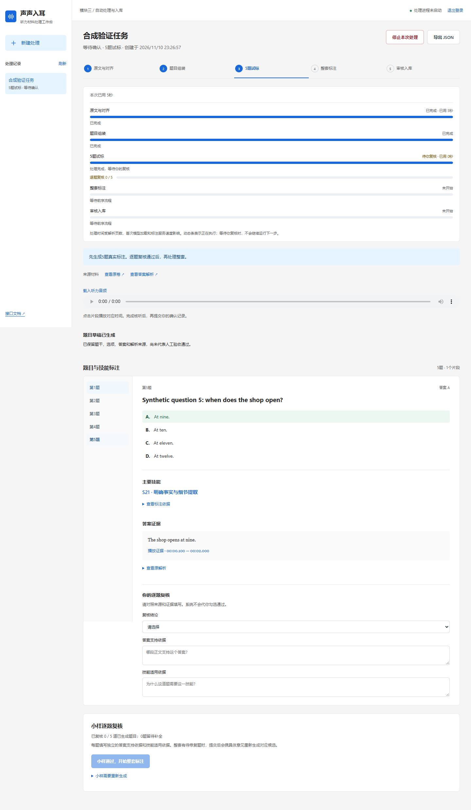
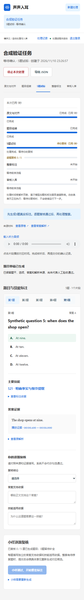

# PR #8：独立工作台交付记录（2026-11-10）

## 本次变化

新增 [单页工作台](../../../tools/module3-console-20261110/README.md)，将此前仓库外的本地实现整理为仓库内独立工具。既有后端业务源码、三套依赖锁、数据库迁移、模型及提示词保持原有版本。

- 上传原卷、答案解析和音频，查看五阶段真实进度、耗时、原件、原音及标注结果；支持桌面与手机。
- 停止当前处理时终止所属 Worker/子进程并撤销租约，保留已有材料及产物，明确重试后创建新任务。
- 对齐异常支持核听后调整搜索窗口或合并相邻同说话人正文，只重对齐受影响片段；保留原始版本、修订原因及实现哈希。
- 单题来源字段提取失败保留题号及已识别内容，空缺列为待补；单题标注失败记录原因后继续，预算耗尽后不再请求。跨页解析支持 OCR 拆分的“析”标签。
- 前五题完成即停在待复核，后续整套须提交实际复核才能启动。完整字段、标注、人工复核及最终入库检查仍是正式入库条件；设为当前批次、学生可见仍须分别明确操作。

新增 `/console-api` 适配接口，均要求管理员认证：配置、工作流创建/状态、原始流上传、启动、结果/源文件、继续、停止、重试、对齐修订、来源校正、返回组装、激活及可见性。原 `/api/v1` 契约未改。继续/停止/修订携带当前 `task_id`，结果操作绑定 `result_hash` 或对齐产物哈希；过期版本返回409。缺口草稿仅供查看和补全，不将缺失项伪装成通过。

路径改为从仓库定位 `backend`；静态页面是直接维护的 `web/` 源码，无 Node 构建步骤。默认新建 `m3_console_local` 独立库；本机已有处理记录未拷入仓库。没有配置历史示例时隐藏入口并返回明确404，不依赖开发者私有验收目录。

## 本次仓库版本验证

Windows x64、原有 Python 3.13.16 API 环境、PostgreSQL 18.6，实际执行：

```powershell
.\backend\.venv-api\Scripts\python.exe tools\module3-console-20261110\verify_checkout.py
.\backend\.venv-api\Scripts\python.exe -m ruff check tools/module3-console-20261110
.\backend\.venv-api\Scripts\python.exe -m ruff format --check tools/module3-console-20261110
```

隔离验证44项通过：新建随机数据库并运行全套增量迁移、认证/权限、上传哈希与路径限制、真实处理进程及子进程终止、租约失效、明确重试、单题失败后继续、前五题范围、自动监控不越过小样复核、缺口阻断正式入库、跨页解析与题号归属、对齐合并限制。每次验证只删除自身创建的库及临时目录；没有付费调用或费用预留。Ruff检查与格式检查通过。

另以本机已有 Playwright/Edge 执行可选浏览器验证，桌面1440px及手机390px共19项通过：登录、缺省示例隐藏、五阶段进度、五题导航、第五题技能与证据、未复核按钮禁用、无横向溢出、页面读取后仍停在五题待复核、无脚本异常。验证器最外层还记录一次浏览器组通过，因此启用浏览器时总检查项为45，不把这一包装项重复计为额外独立用例。

可选浏览器复验：准备本机 Playwright 和 Edge（不加入冻结后端环境），设置 `M3_CONSOLE_BROWSER_TEST=1` 后运行同一验证器。若 Playwright 不在普通 Node 查找路径，设置 `M3_PLAYWRIGHT_PACKAGE` 为其 `package.json` 绝对路径。`M3_BROWSER_CHANNEL` 默认 `msedge`；`M3_CONSOLE_SCREENSHOT_DIR` 可指定截图目录。所有页面数据及模型响应均为合成验证材料。

截图仅展示合成材料的界面，不含原始试卷、用户音频或密钥：





CI 已增加同一隔离验证入口及 Ruff 检查；远端执行情况以本 PR 的实际 Check Run 为准。本次不重复宣称旧提交的后端173用例为新增工作台验收；原后端验证记录见 [前次复验](pr8-followup-20261110.md)。

## 真实材料边界

仓库外本地版本对2025年6月四级第2套已实际生成25题来源草稿，恢复第5题跨页答案/解析，第9、16题解析仍列为待补。按用户要求完成前五题真实技能与证据标注，停在 `annotate_sample / awaiting_confirmation`；未启动后续整套标注或入库。该运行结果不等于人工逐题语义验收通过。

此前本地对齐修订验证运行过真实声学模型，保留未修改片段；这些属于历史开发证据。本次仓库移入验证使用合成来源和响应，没有重新跑整套 OCR、ASR、声学模型或付费标注，不据此签发新材料全线PASS或人工时间精度结论。真实产物、模型、原始材料、数据库、密钥和运行日志均不提交。
