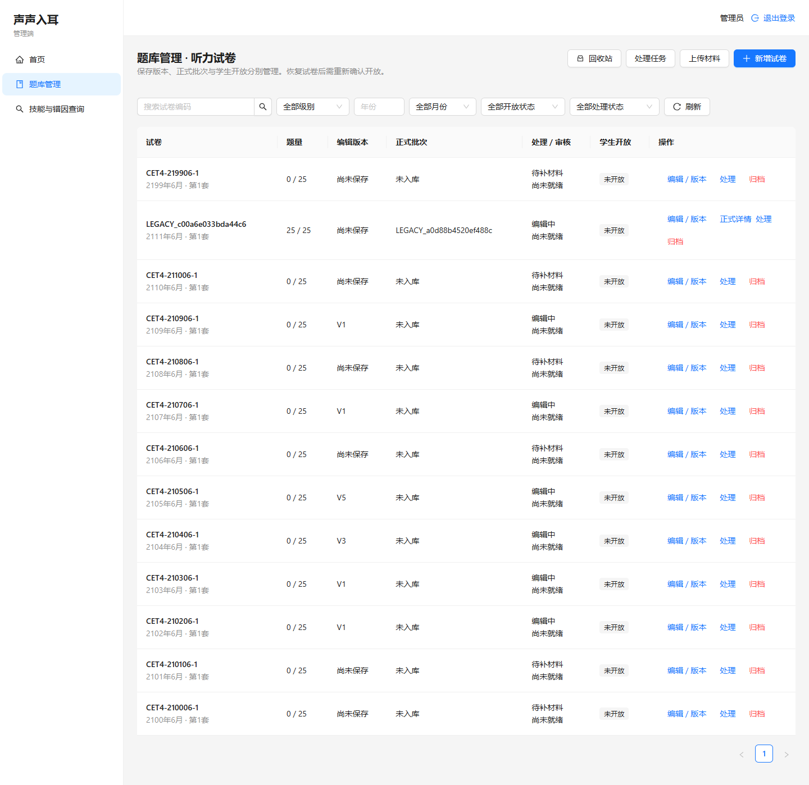

# 题库管理版本验收

关联任务：[模块三题库管理 #26](https://github.com/ShengShengRuEr-Team/ShengShengRuEr/issues/26)。本页区分技术验证与用户实际验收，具体实现及历史验证见 [实施记录](../../../development/module-3/library-management-and-ai-implementation-20261124.md)。

## 页面与验收路径

本地前端默认 `http://127.0.0.1:5173`，开发管理员为 `admin / admin123`。从“题库管理”进入统一试卷列表；“编辑 / 版本”进入共享草稿，可依次检查内容、技能和错因证据、版本记录及模型候选。

建议按以下顺序验收：

1. 组合筛选与翻页；新建人工试卷；编辑内容并预览保存。
2. 检查技能、答案证据、三项错误选项评估的保存及校验反馈。
3. 查看保存版本、差异、回退预览及回退后追加版本。
4. 预览归档影响，归档后在回收站恢复，核对正式开放须重新确认。
5. 检查两家模型配置和候选范围；生成后显式比较和采纳，不自动覆盖编辑头。
6. 完整保存版本准备审核、整套复核、pending 入库、激活及独立学生开放。

页面截图来自2026-11-24的新建隔离环境和合成数据，只用于展示新页面，不代表真实材料语义或实际核听通过：

## AI 版本边界

V1/V2补充提示词与统一V3已作为独立试验文本、实测记录保存。统一V3全25题/75项仅标签相同率为56%，旧V7同口径60%，不据此替换默认生成提示词。来源核听按用户本轮豁免记录，未制造实际听过原音或正式审核的记录。

本页的用户业务验收仍待用户实际操作确认；合成测试和浏览器截图不能替代语义验收。
