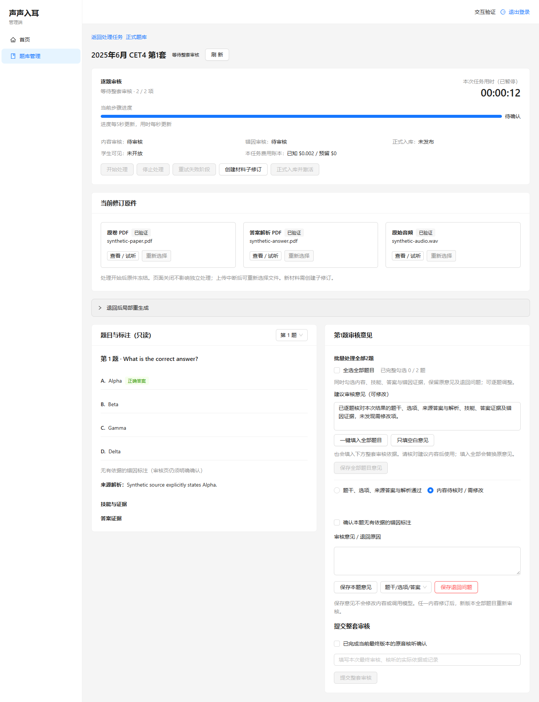
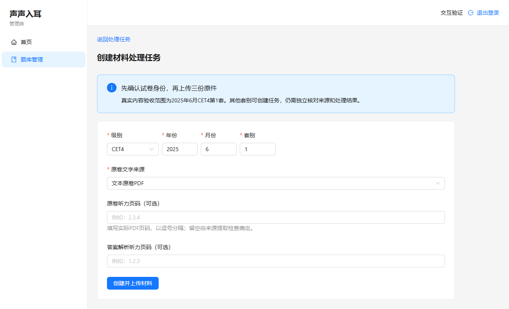

# PR #8：模块三融合答题和题库稳定最小闭环

2026-11-17，Asia/Shanghai。将原PR #8的独立处理基础、统一题库管理续开发和已合入develop的作答系统PR #16汇总到原PR #8源分支，以merge commit合入develop，不重写历史。

## 本轮交付

管理员在同一题库应用上传原卷、答案解析和音频，经独立Worker处理、阶段确认及当前版本逐题审核后发布；学生可见仍须独立确认。学生从练习列表作答，在本浏览器恢复草稿，提交判分后只读回看。旧正式卷在新修订审核期间保持可用，发布换批不改历史作答快照。

具体错误选项的错因只在管理端展示；本轮修复兼容运行更新后有效正式标注被误隐藏的问题，以及自动处理英文题型代码与249分制判分的适配问题。合流使用0007—0009增量迁移，保留原作答和模块三两支迁移历史。

## 已取得验证

- 完整隔离技术复验：API 477项中463通过、14项专属环境用例跳过；ASR 10项、OCR 7项分别在冻结Python 3.13.16环境通过，失败/错误0，迁移及自身测试库清理通过。
- 前端129项通过，冻结Node 24.14.0/npm 11.9.0下typecheck/build通过；管理交互58项及25题批量审核93项通过。
- 两套已审核真实文本卷在1440×900和1280×720完成4次25题学生提交；180项断言通过，均25/25、100%、练习估分249，同键重试不增作答，刷新只读回看。
- 发布前另复验原独立工作台CI入口：Ruff及`verify_checkout.py`的44项隔离检查通过，付费调用0。
- 首次新提交在GitHub已通过完整API/迁移回归，但独立工作台隔离断言因Windows的TEMP短路径别名误报。已用真实8.3目录别名在本机复现；检查器改为两侧均规范化后严格比较同一目录，不放宽隔离条件、不修改业务路径或测试库清理规则；同一别名场景的44项修复复验通过。失败及修复按各自提交保留，不把旧失败记成成功。
- 本次推送和合并以GitHub当前提交检查为准；本机详细证据不提交源码。完整映射和实测边界见[融合验收报告](continuation-attempt-20261117.md)。

## 桌面页面

以下均为本轮合成接口交互截图，仅展示统一管理入口及审核交互，不含真实试卷、音频、凭据或个人账户数据，不作为真实语义批准。

## 仍保留的边界

本次合并交付稳定最小闭环，不签发续开发需求全部通过：指定300dpi扫描卷仍待实际核听，以及同实例材料子修订后的来源/试标/整套审核和发布证据；两路从统一浏览器重新上传起的完整真实质量复验也未全部补齐。不会复制文本审批或用合成测试代替这些记录。手机端、服务端草稿、跨设备、限时考试、学生错因及推荐不在本轮交付范围。

需求见[续开发需求第十一节](../../requirements/module-3/continuation-20261115.md)，操作见[统一管理运行说明](../../development/module-3/continuation-runbook.md)。Refs #7。
