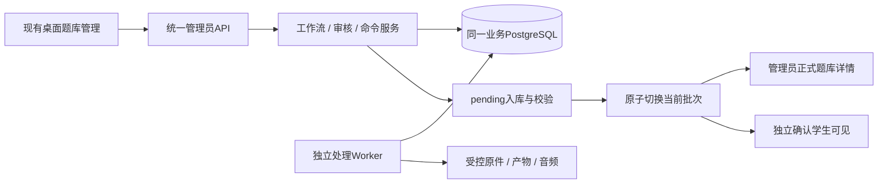

# 模块三续开发设计：统一题库接入与选项错因

| 项目 | 内容 |
| --- | --- |
| 版本 / 日期 | V1.0-r1 / 2026-11-16（Asia/Shanghai）；初版2026-11-15，文件路径保持不变 |
| 本次修订 | 按2026-11-16静态审查R01—R03补齐幂等恢复、上传租约/子修订及证据子关系约束，同步任务和验收；这是设计修订，不是运行验证结论 |
| 需求依据 | [续开发需求及33项验收条件](../../requirements/module-3/continuation-20261115.md)，未替代内容沿用[需求V2.3](../../requirements/module-3/requirements.md) |
| 本文状态 | 开发设计契约；统一前后端链路及技术验证见[实施记录](implementation-20261116.md)，操作方式见[运行说明](continuation-runbook.md)；真实两路人工审核及33项完整验收未全部完成 |
| 技术基线 | [统一技术版本V1.2](technical-version.md)，冻结编号 `M3-WIN64-1.1.0`；本文不升级解释器、依赖或模型 |
| 本次交付 | 桌面管理端上传、处理、只读审核/退回、正式入库和标注回读；选项错因及三项方案A |
| 不纳入 | 手机端、页面内容编辑器、学生错因展示、六级/其他版式真实内容验收、上传字节级断点续传 |

本文定义后续实现采用的结构和契约。下文“新增”“调整”均为实施任务，不表示代码已经存在。需求文档保留业务决定，本文承载实现方法；历史开发计划和验收数字不改写为本次结果。

## 1. 现有代码核查与集成方式

### 1.1 本地基线

2026-11-15只读核对以下本地提交，未查询远端最新状态，也未检查实际数据库迁移版本。

| 来源 | 本地HEAD | 复用内容及实际差距 |
| --- | --- | --- |
| 稳定题库 `ShengShengRuEr` | `846270b8f6ee35affc1ec4f1daaca4f018ae3be4` | 有React/Ant Design题库列表、详情、学生页面及作答系统；`app.main`尚未装配模块三路由 |
| 模块三 `ShengShengRuEr-module3` | `224bbef82b4ee15c26a833e28565101628a96f37` | 有任务、草稿、复核、pending入库、激活及独立工作台；本目录前端不包含稳定题库的全部业务页面 |
| 当前文档工作区 | 含未提交需求/约定修改 | 原有修改继续保留；本次编写文档不切换分支、不合并、不运行迁移 |

实施从最新研发集成分支建立独立任务分支，先纳入稳定题库及模块三的必要实现，记录实际来源SHA和冲突解决；不能用任一目录整体覆盖另一个目录。发布前保持单一应用代码、认证、业务数据库与媒体配置，不能让浏览器跨两个独立管理系统搬运结果。

### 1.2 复用与修改定位

| 已有位置 | 实施处理 |
| --- | --- |
| [任务与审核模型](../../../backend/app/db/models_processing.py) | 复用材料、任务、产物、草稿、复核、校正及计费记录；补充业务工作流和逐题审核持久化 |
| [处理服务](../../../backend/app/services/processing/tasks.py) | 保留哈希、租约、复核、校正、激活；新增统一守卫，收紧来源校正白名单，禁止继承新结果的逐题通过结论 |
| [独立Worker](../../../backend/app/module3/worker.py) | 继续在处理环境运行；按持久化命令调度并支持停止后的fencing，不依赖浏览器或API进程生命周期 |
| [pending入库服务](../../../backend/app/services/processing/persistence.py) | 保留非当前批次、音频文件发布及失败清理；接入可恢复发布操作 |
| [候选模型和提示词](../../../backend/app/module3/annotations.py)、[候选检查](../../../backend/app/module3/annotation_checks.py) | 错因选项必填、排除正确选项、允许空列表、多错因及证据去重；重做小样复用判断 |
| [错因及证据模型](../../../backend/app/db/models_annotations.py) | 现有关系表增量升级，保留历史，不新建平行错因业务表 |
| [独立工作台适配层](../../../tools/module3-console-20261110/server.py) | 提取上传、阶段编排和停止逻辑；移除新入口对本地JSON工作流、全局进程锁、示例目录和自动建库的依赖，不直接导入其启动副作用 |
| 稳定前端 `frontend/src/pages/admin/ListeningPaperListPage.tsx`、`ListeningPaperDetailPage.tsx` | 在集成分支保留并扩展，新增处理任务页；沿用布局、登录、路由守卫、请求封装和音频鉴权 |
| 稳定后端 `app/api/attempts.py`、`app/services/attempts.py`及相关模型 | 保留作答、判分及历史记录；作为迁移和版本切换回归范围 |

### 1.3 先解决Alembic双分支

两个来源都从 `0004_expected_count_source` 分叉，但revision ID不同：稳定来源为 `0005_attempt_system`；模块三来源为 `0005_module3_processing → 0006_module3_invariants`。文件名前缀相同不代表同一个revision，不能重命名或删除已经使用的历史revision来强行串联。

集成后新增merge revision，`down_revision = ('0005_attempt_system', '0006_module3_invariants')`，随后追加本次结构迁移及约束迁移。建议ID依次为 `0007_m3_attempt_merge`、`0008_m3_continuation`、`0009_m3_error_invariants`；实施前核对实际heads，如新增迁移已占用编号则顺延并同步本文。merge revision不删除数据，历史两支先完整执行，再执行新迁移。升级测试覆盖空库、仅模块二、仅作答、仅模块三以及含存量错因的组合库。

## 2. 总体结构与代码组织



1. 浏览器只访问统一API；接口统一使用 `/api/v1`、`snake_case`及 `{code,msg,data}`，所有管理和媒体路由使用 `require_admin`。
2. API环境只负责鉴权、数据库事务、上传和命令接收，不在请求中执行OCR、对齐或长时间模型调用。
3. 处理环境运行独立Worker，OCR继续调用独立OCR解释器；API与Worker读取同一持久化工作流、命令和材料身份。
4. 保留现有单处理并发基线，不引入新的任务队列产品。可恢复命令表承担本次编排，不建设通用调度平台。
5. 结果文件保持不可变；数据库保存身份、状态、引用和审核。所有成功写回检查任务租约、当前修订及命令执行权。

新增文件的建议职责如下；实施时允许同职责小范围合并，不把核心逻辑写进页面或路由函数。

| 新增/调整位置 | 职责 |
| --- | --- |
| `backend/app/api/admin_processing_workflows.py` | 工作流、文件、阶段确认、审核、重处理和发布HTTP契约 |
| `backend/app/schemas_processing_workflows.py` | 严格DTO、分页、命令前置条件、逐题审核与错误码 |
| `backend/app/db/models_processing_workflows.py` | 工作流、修订、上传、命令、阶段确认及逐题审核模型 |
| `backend/app/services/processing/workflows.py` | 工作流状态转换、数据库锁、修订和任务绑定 |
| `backend/app/services/processing/reprocessing.py` | 依赖比较、修复计划、小样有效性和来源校正入口 |
| `backend/app/services/processing/publication.py` | 可恢复pending入库、检查、复核映射和激活 |
| `backend/app/repositories/annotations.py` | 草稿/当前/历史三类标注读取、版本门控和有界查询 |
| `backend/app/module3/annotation_identity.py` | 新规则身份、内容指纹与规范化，供API和Worker共用 |
| `frontend/src/api/processing.ts`、`processing-types.ts`、`processing-adapters.ts` | 新接口、DTO和页面模型适配，不扩展学生DTO |
| `frontend/src/pages/admin/processing/`及局部组件 | 上传、任务、只读审核、逐题导航和问题反馈 |

## 3. 身份、版本与不变量

### 3.1 区分五种身份

| 身份 | 定义及用途 |
| --- | --- |
| 试卷身份 | `exam_level + exam_year + exam_month + paper_set + content_scope=listening`；与既有 `exam_paper_code/id`关联，编码变化不能另建同一业务试卷 |
| `workflow_id` | 管理员可持续访问的业务工作流；关联试卷及其各次修订，不等同一个Worker进程 |
| `revision_id` | 一次材料/内容修订；来源清单冻结后不原地替换，最终结果冻结后不覆盖 |
| `task_id` | 一次具体阶段执行，沿用 `processing_tasks`；重试、修复均保留父任务和新执行记录 |
| `batch_id` | 实际业务入库批次；只在pending入库时建立，与修订最终结果绑定 |

创建工作流时按试卷自然身份查重；发现相同自然身份对应不同旧编码时返回身份冲突并列出待核对对象，不猜测合并。执行前审计既有重复身份；只对核对无冲突的数据建立唯一约束/身份锁规则，不能删除试卷或作答记录来凑唯一性。正式题库列表只返回存在有效当前正式批次的试卷，只有上传记录的试卷不混入正式列表。

### 3.2 本次新增业务版本

冻结以下新标识，属于业务方法修订，不改变三套依赖冻结编号：

| 标识 | 新值 | 旧值处理 |
| --- | --- | --- |
| 结果结构 | `m3.v2` | 原 `m3.v1`结果保留追溯 |
| 错因规则 | `m3.option-errors.v1` | 无新规则身份的存量标注记为 `legacy`，禁止当前错因业务使用 |
| 候选提示词 | `m3.annotations.v6` | 旧 `m3.annotations.v5`候选不能冒充新生成 |
| 校验规则 | `m3.checks.v2` | 旧检查不能证明本次选项归属及完整审核通过 |

规则清单记录提示词正文哈希、候选结构哈希、词典快照哈希、适用代码/方法哈希及生成参数。清单由服务端配置生成，不能由客户端自由指定“已通过版本”。词典继续使用已确认快照；本次不重建错因分类，也不自动跟随文件修改时间更新词典。

### 3.3 指纹分层

- `materials_hash`：同套输入种类、SHA-256、派生关系、实际页码及文字来源模式的规范化摘要。
- `question_input_hash`：某题基准题干、四个基准选项、基准答案、解析、同篇正文/分句、引用的有效对齐及来源定位。
- `stage_dependency_hash`：仅包含该阶段实际依赖；小样使用前5题身份/顺序、相应正文和共享方法，不因无关第12题变化而直接失效。
- `result_hash`：新版本规范化整套内容、所有关联与证据、来源及规则身份；审核人、审核意见、读取时间和数据库自增ID不参与内容哈希。
- `row_version`：工作流/审核会话的乐观锁版本，仅保护并发写；不能代替内容哈希。

在统一身份模块实现新版本哈希，API、Worker、校正、检查、入库和读取调用同一实现。旧版本哈希函数保留；不得以新算法重算后静默覆盖历史哈希。新增结果版本的哈希规则须有固定向量验证，不能仅改提示词版本却沿用不含新上下文的旧指纹。

工作流 `row_version`只在业务操作、当前修订/任务指针或门控状态变化时递增；心跳、耗时和纯进度计数不递增该版本，避免轮询令正在填写的审核表单持续过期。审核会话有自己的版本，保存意见不改变内容哈希。

### 3.4 必须保持的不变量

1. 自动处理不激活批次；审核通过不等于学生可见。
2. 任一内容或标注变化后，新结果整套逐题重审；复用产物和小样阶段门控不继承最终逐题通过结论。
3. 旧正式版本在新版本待审核、失败期间保持原状态；成功切换到不同新批次后，该新批次默认隐藏。相同结果幂等重试不清除已存在的可见确认。
4. 合法空错因必须有成功生成记录及当前版本的审核通过记录；任务失败、未生成、历史停用不等于合法空结果。
5. 原件、自动初稿、模型原始响应和历史审核不可变；已发布内容修改创建修订。

## 4. 数据模型与约束

### 4.1 复用表与扩展点

保留 `material_sources`、`processing_tasks/artifacts/drafts/reviews/corrections`、`processing_llm_attempts`、`dictionary_snapshots`及既有题库/批次/证据表。`processing_tasks`新增可空 `workflow_id/revision_id`外键，以兼容历史任务；新工作流创建的任务必须具有这两个绑定。

执行状态在原约束基础上新增 `stopping/stopped`，不能只在界面伪造已停止。服务端所有状态白名单、轮询和租约领取同步修改。新增列、索引及触发器通过增量迁移建立。

### 4.2 新增持久化对象

| 表 / 关键字段 | 唯一性、写入及恢复规则 |
| --- | --- |
| `processing_workflows`：UUID主键、试卷自然身份/可空试卷ID、当前修订、当前任务、四维状态、`row_version`、创建/更新人和时间 | 同一工作流只指向一个当前修订；当前修订必须属于该工作流。列表按创建时间+ID游标分页，增加试卷信息和状态组合索引 |
| `processing_workflow_revisions`：UUID、工作流、递增序号、父修订、材料清单、规则清单、阶段指纹、可空最终任务/哈希/批次、冻结时间 | 唯一 `(workflow_id, revision_no)`；最终内容冻结后不得替换哈希或来源。业务阶段任务均归入明确修订 |
| `processing_workflow_materials`：`upload_id` UUID、修订、材料种类、上传版本、状态、材料ID、声明/实际大小和哈希、失败码、原始文件名、接收令牌/执行身份、租约截止及更新时间 | 唯一 `(revision_id, kind, upload_version)`；修订为每类材料维护一个当前上传引用，并校验同修订同种类归属。替换追加记录并撤销旧接收权；冻结修订禁止替换。上传租约、状态及失效恢复见§4.2.1 |
| `processing_workflow_commands`：UUID、工作流/修订、动作、幂等键、请求摘要、前置版本、状态、结果引用、租约/执行令牌、失败码、创建人及时间 | 唯一 `(created_by, action, idempotency_key)`，请求摘要含动作、目标及原始前置条件；先查幂等记录，再校验新命令的当前版本。同键同请求回放，同键不同请求409；创建命令与新工作流同事务绑定。命令及幂等身份本轮不自动淘汰；不能仅放内存队列 |
| `processing_stage_approvals`：修订、阶段、产物及依赖哈希、决定、逐项依据、操作者/时间、复用来源审批ID | 追加保存；小样、来源及核听确认各自有明确绑定。复用记录保存本次依赖比较，不改写原审批 |
| `processing_review_sessions`：UUID、修订、最终结果哈希、状态、`row_version`、提交人/时间 | 每个修订最终哈希仅一个当前整套审核会话；新内容修订新建会话，不复制通过项 |
| `processing_review_items`：会话、题目基准身份、内容/主要技能/答案证据/逐条错因及空错因确认、意见、问题定位、操作者/时间 | 唯一 `(session_id, question_src_id)`，字段/关系决定以稳定身份保存；有界批量保存、CAS更新并记录变更事件 |
| `processing_workflow_events`：工作流/修订/任务/命令、事件类型、前后状态、对象引用、操作者/执行身份及时间 | 追加审计；不保存密钥、受控绝对路径或完整模型敏感请求到页面日志 |
| `question_annotation_states`：批次/题目、修订、规则及依赖清单、生成任务/候选产物引用、错因生成状态、最终审核会话 | 每批次每题一条；合法空列表也有此行。复合外键校验题目所属批次，审核会话须匹配该修订最终结果 |

`question_annotation_states`用于批次级状态和生成追溯，不存第二份错因标签集合；标签和证据仍保存在原关系表。草稿阶段的逐题生成状态保存在不可变候选产物及修订结果投影中，不能因尚无批次状态行判断“无错因”。历史卷没有状态行时按 `legacy_pending`返回。

材料上传期间以修订和单文件版本控制并发；长时间接收文件不持有数据库行锁。开始处理时锁定工作流，按§4.2.1处理已失效上传，再检查三类当前选中上传均为ready、没有仍有效的接收/验证租约，冻结清单。历史失败、取消及被替代的上传不阻断开始；当前选中上传失败则仍待补材料，不能静默退回旧文件。修订和工作流的双向引用初始化可先为空，提交前补齐且验证归属。

### 4.2.1 上传生命周期与材料修订

上传先登记、再传输：管理员通过幂等命令预留本次上传，服务端在短事务内分配 `upload_id/upload_version`、更新本类当前上传引用并返回新工作流版本；随后二进制PUT只向该上传写入。服务端状态如下，不承诺字节级续传。

| 状态 | 进入与退出规则 |
| --- | --- |
| `reserved` | 预留成功，等待PUT；无人传输也有有限租约，不能永久占位 |
| `uploading` | PUT按当前上传身份领取独立接收令牌；按实际接收进度续租，同一上传只允许一个有效接收者 |
| `validating` | 接收完成，执行大小/哈希及真实格式检查；验证器继续持有并续期同一执行权，尚不能作为ready材料使用 |
| `ready` | 文件验证及材料登记成功，且当前修订、上传引用、版本、令牌和租约仍匹配，才原子写入材料引用；租约结束 |
| `failed` | 网络/文件/登记失败或租约到期；保留原因。到期记 `UPLOAD_EXPIRED`并撤销令牌，不自动改成ready |
| `cancelled` | 管理员显式取消未完成上传，撤销接收权；已登记原件仍保留 |
| `superseded` | 管理员显式预留替换上传后，旧上传退出当前选择并撤销执行权；原材料和审计记录保留 |

1. 租约时长及续租周期来自统一服务端配置，续租周期必须短于租约；服务端按进度及执行身份续租，不能仅凭浏览器仍在线就无限续租。API启动恢复及后台恢复扫描以数据库时间识别到期项，GET仅返回真实状态及到期提示，不执行恢复写入。显式开始命令也核对到期项；不存在“重启后自动视为上传成功”的分支。
2. 断网/进程退出后，管理员可立即显式取消或预留新上传版本，不必等待旧租约到期；预留命令须携带期望修订、工作流版本及本类当前上传版本，原子替代旧引用。失败只影响本文件，其他两类材料保持。当前失败文件须显式重传；同哈希原件可经验证复用存储，不自动回退旧上传记录。
3. 旧接收者在续租、发布文件和最终登记时均检查执行权；旧上传晚完成、重复PUT及过期令牌不能覆盖新上传、冻结清单或其他修订。ready上传的重复PUT返回409 `UPLOAD_NOT_WRITABLE`并引导读取已有状态；不把请求体视为一次新替换。
4. 进程崩溃后的暂存由恢复扫描核对上传身份、租约及引用后清理；不能按目录或文件名批量删除。内容寻址文件的复用和提交不确定时处理继续遵守§8.3及§9.3。
5. 对已冻结修订补传/替换材料，先显式创建子修订：校验期望工作流版本和父修订，无活动处理/发布命令后原子建立子修订及当前指针；有活动执行时返回409，先停止或等待其结束。未替换材料在子修订新建ready引用记录及当前上传引用，指向同一已验证原件并保留来源，不重新传输；不复制最终结果、逐题通过结论或整套审核，有效阶段审批仍须按依赖重新核验。返回新 `revision_id/row_version`后再预留上传；旧修订不解冻、不覆盖。校正及重处理入口使用同一子修订服务，不另建不受控分支。

### 4.3 原错因表增量升级

在 `error_question_relations`增加：

| 字段 | 含义 |
| --- | --- |
| `rule_version` | 默认 `legacy`；新写入由服务端固定为 `m3.option-errors.v1`，客户端不能自称新规则 |
| `business_eligible` | 默认false；只表示符合新规则候选身份，不代表已审核、当前批次或学生可见 |
| `annotation_state_id` | 关联本批次本题生成状态；新候选父关系必填，证据子关系通过父关系验证同一状态 |

保留已有 `option_letter`、`QUESTION_ERROR_CANDIDATE`父关系及 `CANDIDATE_EVIDENCE`子关系。父关系使用基准字母；证据子关系不要求重复填写选项。模型理由映射到原 `attributes_json.trigger_mechanism`，支持说明映射到证据子关系 `support_note`，不另造冲突的理由来源。

约束按层落实：

1. 条件CHECK：仅新规则候选父关系要求合法A—D选项、生成状态引用及规范理由；不能把整列直接改为NOT NULL，历史空选项和证据子行仍可存在。
2. 部分唯一索引：当前新规则候选父关系按 `(batch_id, question_id, option_letter, error_cause_id)`唯一；不能只按错因编码去重。
3. 沿用同批次题目、父关系和证据的复合外键，补足生成状态的归属检查；复合外键不代替父关系类型及同篇证据检查。多条有序证据仍挂在同一个父关系上。
4. 新增数据库约束触发器检查新规则父关系的选项不等于同批次题目的 `correct_option`、词典快照正确、生成状态同题同批次。不能在CHECK里写跨表查询。
5. 修改题目正确答案或基准选项时，同样重新校验既有新关系；已冻结/已发布内容禁止原地修改，强制新修订。服务层先报可理解的422/409，数据库兜底并发或其他写入入口。
6. 证据子关系INSERT/UPDATE须校验owner确为同批次的 `QUESTION_ERROR_CANDIDATE`，不能指向另一条 `CANDIDATE_EVIDENCE`。只要子关系或实际父关系适用新规则，就执行新规则校验：子关系规则须与父关系一致，经父关系绑定同一生成状态；子行的可空 `annotation_state_id`若填写必须与父行一致，不能靠子行默认legacy或 `business_eligible=false`绕过。新规则子关系不能挂到legacy父关系上。
7. 新规则证据须与父关系题目属于同一篇章，引用的证据片段也须属于该篇章、为有效正文且满足连续有序要求；证据子行不重复要求选项非空。数据库验证归属和结构，证据是否足以解释该选项错因仍由逐条语义审核决定。
8. 约束同时覆盖父关系的题目/规则/状态引用、题目篇章以及证据/片段归属更新，禁止修改冻结内容绕过检查。关系可在同一事务中先后插入，跨行约束在提交前检查完整状态；每个当前新规则父关系最终至少有一条有效证据，删除最后一条也须拒绝。关联写入按统一锁顺序串行化并复核，不能仅让两个并发事务各自检查旧快照。历史仅审计数据按版本保留，不追溯套用新选项/证据约束；触及新规则关系的变更仍严格检查。

完全相同的候选重复项规范化后只建一个父关系；相同父关系的有效证据按句子/字符范围指纹去重并保留顺序。理由或证据有实质冲突时阻塞，不采用最后一条覆盖。修改触发器、旧关系结构CHECK时同步SQLAlchemy模型与迁移，不能只改模型声明。

## 5. 状态流转与审核

### 5.1 状态维度

| 维度 | 业务枚举 |
| --- | --- |
| 处理 | `uploading / materials_required / queued / processing / awaiting_gate / ready_for_review / failed / stopping / stopped` |
| 内容审核 | `not_ready / pending / in_review / changes_required / approved` |
| 错因生成 | `legacy_pending / not_generated / generation_failed / generated_empty / generated_nonempty`，按题记录 |
| 错因审核 | `pending / changes_required / approved`，绑定当前最终结果；未生成时不能approved |
| 入库 | `not_started / preparing / pending_batch / validating / activating / published / failed / conflict` |
| 学生开放 | 读取当前批次的既有 `paper_visibility`，不复制一个可独立修改的真假值 |

前端展示五阶段：材料与来源提取、正文及音频对齐、题目组装、候选标注、审核与入库；每个阶段包含真实内部步骤。第六节API返回当前内部stage和门控，不能仅返回五个完成图标。

### 5.2 执行顺序

1. 创建工作流/修订，逐份上传并验证三种材料。
2. 显式开始后创建任务，执行原文提取、分句、音频处理与对齐；缺正文、题组或来源冲突进入待补/退回，不自动启用ASR。
3. 在对齐处暂停，保存真实核听和来源确认；继续动作再次检查版本及阶段审批。
4. 组装题目、核对可信原卷题量；准备前5题新规则标注，完成后暂停复核。保存审批本身不发起收费调用，管理员显式继续后才处理整套。
5. 整套输出冻结最终结果，建立审核会话。列表分页展示全部题及缺口，逐题保存决定；合理空错因须明确确认。
6. 任一题被退回可保存问题；显式执行来源校正或局部重生成后产生新内容修订，最终整套审核进度全部归零，旧意见可追溯。
7. 整套审核提交通过后可执行“审核通过并入库”；后端持久化发布命令，完成pending、检查、复核绑定和当前版本切换。
8. 发布成功后跳转正式试卷详情；另行确认学生可见。切换后的新卷默认隐藏，页面明确提示，不能用上传或入库审批代替开放确认。

### 5.3 逐题和整套审核

逐题记录至少覆盖题干/选项/来源答案解析、主要技能及其证据、答案证据、每条选项错因及其证据；无错因时保存明确的空结果确认。退回项有题目/阶段、字段或关系ID、问题类型、来源引用和原因。

保存审核意见只写审核数据和事件，不修改结果内容、不生成新内容哈希、不自动调用模型。整套提交时服务端按可信原卷题目集合检查逐题项完全覆盖、没有未决缺口或退回项、候选及证据校验通过，并比较最终结果哈希和会话版本；不能只相信前端传 `approved=true`。

原有 `processing_reviews`继续作为最终内容/音频/标注复核的不可变记录：由会话提交服务生成覆盖清单并调用统一校验，绑定同一最终哈希及实际操作者，不由Worker自动代填通过。早期核听/小样阶段审批只作为阶段依据；新内容结果的最终整套复核仍重新取得，不把旧阶段记录直接充当新最终审核。

量化音频验收继续按原需求记录正文起止各≤300ms及实际参考边界。若存在明确用户核听批准，只能保留真实审批来源和哈希，不能补造毫秒参考值或把批准写成独立量化精度通过。本次选择方案A不构成对任何新音频的核听批准。

### 5.4 存量迁移例外

仅停用旧错因时，不重置旧卷有效内容审核、当前批次、音频绑定、学生可见或作答记录；管理端并列显示“内容已审核 / 新错因待重新标注”。生成新错因属于新内容修订，按整套重审、发布和重新确认可见的规则处理，不能原地补回旧正式批次。只读历史页可查看明确标识的审计产物，当前错因查询不得返回旧标签。

## 6. 前后端接口契约

### 6.1 通用约定

本节接口为新增或调整后的目标契约，尚未实现。保留现有低层材料/任务/批次接口以支持工具，但新页面统一使用业务工作流接口；任何旧入口进入新规则审核、校正或激活时必须调用同一守卫，不能从旧 `/console-api`或低层接口绕过新规则。

- 所有接口先执行认证、管理员鉴权及目标访问控制；无凭据401，学生调用403，对象不存在404。命令按§9.1先判定已受理的幂等请求，只有首次受理才校验当前版本；查询原操作不要求当前业务版本仍等于原请求。
- JSON请求使用严格模型，拒绝未知字段；审核者身份及时间来自登录会话和服务端，不接受客户端伪造用户名。
- 列表默认20、最大100；结果按篇章/题分页，默认25、最大100。返回 `items/next_cursor`和结果版本；分页过程中版本变化返回409，不能拼成混合版本。
- 对已有工作流的修改类JSON请求包含 `expected_workflow_version`、`expected_revision_id`；涉及结果时额外包含 `expected_result_hash`，阶段操作包含 `expected_stage_dependency_hash`。创建工作流尚无这些身份，不要求伪造空前置条件；其他动作按契约校验必需值，不能用空值表达忽略版本。
- 创建及命令请求带 `Idempotency-Key` UUID；响应带 `operation_id`及实际状态。相同键同请求复用原操作，相同键不同内容409。前端发送前保存原键、动作、目标及原请求；超时有操作ID则按ID查，无ID则按原键查，不换键盲发。命令回放及未查到时的恢复边界见§9.1。
- 成功JSON沿用统一外壳；错误保持 `data=null`，新增可选 `error_code/context`，上下文仅含任务/修订/冲突版本等安全字段。前端为旧错误外壳保留兼容，不把业务错误当网络成功。
- 文件响应为带鉴权的二进制流，不套JSON外壳；媒体错误仍返回统一JSON，前端二进制适配器负责解析。

### 6.2 目标路由

以下 `W`代表 `/api/v1/admin/processing-workflows`，`w/r/s/c`分别为工作流、修订、审核会话和命令ID。

| 方法 / 路径 | 输入与输出要点 | 写入/执行边界 |
| --- | --- | --- |
| `GET W/capabilities` | 格式、最大字节数、可用输入配置、规则版本、预算上限及处理环境是否就绪 | 不返回数据库名、密钥或绝对路径；不启动诊断推理 |
| `POST W` | 试卷元数据、文档模式、可选听力页码；返回 `workflow_id/revision_id/row_version`及身份冲突 | 幂等创建；服务端确定规则和来源模式，不接受费用清零参数 |
| `GET W/operations/by-key` | 查询参数 `action/idempotency_key`；服务端固定为当前管理员，返回原操作ID、工作流/修订及状态 | 适用于创建响应丢失、尚无workflow_id的情形；只读，不执行命令、不做当前版本校验。未查到返回404 `OPERATION_NOT_FOUND`，不表示旧请求一定未受理 |
| `GET W` | 考试信息、四维状态、游标和limit；返回当前阶段、缺口及下一操作 | 一次聚合查询，禁止逐题扇出 |
| `GET W/{w}` | 当前修订/任务、逐文件上传身份/状态/失败原因、阶段检查点、计数、耗时、门控、费用、允许操作及阻断原因 | 页面刷新和重新登录的恢复来源；上传到期提示不产生GET写入副作用 |
| `POST W/{w}/material-uploads` | `kind`、文件名、声明大小/可选哈希、期望修订/工作流/本类上传版本；返回 `operation_id/upload_id/upload_version/row_version`及状态 | 幂等预留当前未冻结修订的单文件上传；显式替换撤销旧接收权，不接收文件体、不启动处理 |
| `PUT W/{w}/materials/{kind}` | 原始二进制，头部 `X-Upload-Id/X-Expected-Revision-Id/X-Expected-Upload-Version`携带预留身份；返回上传记录、材料引用和当前版本 | 仅写指定上传；接收和最终登记均验证当前上传及执行权。逐文件流式接收，不把512MiB整体读入内存；`kind=paper/answer/audio` |
| `POST W/{w}/material-uploads/{upload_id}/cancel` | 期望修订、工作流/上传版本及原因；返回操作及上传状态 | 幂等取消未完成上传并撤销接收权；不删除已登记原件、不取消其他材料 |
| `GET W/{w}/materials/{material_id}` | 当前修订引用和可选预览页 | 验证文件引用及哈希，鉴权返回原件/派生预览；不接受任意存储路径 |
| `POST W/{w}/start` | 当前版本；返回排队命令 | 仅材料ready、身份及能力配置匹配时冻结清单并创建任务 |
| `GET W/{w}/revisions` | 修订历史、父版本及来源，分页 | 旧错因只在明确审计视图读取，不混入当前候选 |
| `POST W/{w}/revisions` | 期望工作流版本、父修订及材料替换原因；返回 `operation_id/revision_id/row_version` | 按§4.2.1幂等创建可上传的子修订；当前指针切换同事务，无模型调用，不继承最终审核 |
| `GET W/{w}/revisions/{r}/questions` | 题目/状态过滤、游标、期望结果哈希 | 返回题目、答案、主要技能、证据、按选项分组错因及逐题生成状态 |
| `GET W/{w}/revisions/{r}/stages/{stage}` | 当前阶段产物身份及有界结果 | 大列表分段；不能返回密钥、私有目录和完整内部配置 |
| `POST W/{w}/stage-approvals` | 阶段、产物/依赖哈希、决定、逐项依据 | 仅保存阶段确认；音频/小样未实际确认时不通过 |
| `POST W/{w}/continue` | 阶段依赖哈希及允许的目标动作 | 显式继续，重新验证门控和预算；轮询从不调用此接口 |
| `POST W/{w}/stop` | 当前任务/修订及原因 | 持久化停止意图，撤销对应任务执行权，不停止其他工作流 |
| `POST W/{w}/retries` | 失败任务、期望输入哈希、原因、阶段 | 新子任务，复核实际状态后恢复；不无条件重复收费阶段 |
| `GET W/{w}/review-sessions/{s}` | 审核覆盖数量、逐题已保存状态和问题，分页 | 绑定冻结最终结果；不同修订不可共用会话 |
| `PATCH W/{w}/review-sessions/{s}/items` | 会话版本、结果哈希、最多25题的审核决定和意见 | 只改审核数据；保存返回新会话版本及服务端计算的覆盖情况 |
| `POST W/{w}/review-sessions/{s}/returns` | 题目/阶段、问题类型、原因、来源/字段/证据定位 | 保存退回及问题，不自动重跑；无原因拒绝 |
| `POST W/{w}/review-sessions/{s}/submit` | 会话版本及最终结果哈希 | 校验整套实际覆盖并生成完整复核记录；有缺口不通过 |
| `POST W/{w}/reprocess-preview` | 选定修复题/阶段、反馈及期望版本 | 只计算依赖影响、小样有效性和执行计划，返回 `plan_hash`；不调用模型 |
| `POST W/{w}/reprocess` | 已确认 `plan_hash`及版本 | 重新计算比较计划后创建修订/子任务；影响范围扩大或计划过期409 |
| `POST W/{w}/source-corrections` | 白名单校正文件内容、原页依据、前值/哈希和原因 | 仅受控工具调用；实际鉴权及新修订规则同页面，不能修改候选标签 |
| `POST W/{w}/publish` | 最终审核会话、结果哈希、`expected_current_batch_id` | 返回202及发布操作；执行第9节可恢复流程，不能立即报已入库 |
| `GET W/{w}/operations/{c}` | 命令实际状态、阶段、批次/试卷ID、失败码和可恢复操作 | 网络超时及服务重启后先查询；GET无执行副作用 |
| `GET W/{w}/revisions/{r}/evidences/{e}/audio` | 结果内的证据身份 | 管理员鉴权，按已验证原音及时间返回试听数据；不接受任意URL/路径 |
| `GET /api/v1/admin/listening-papers/{id}/annotations` | 可选期望当前批次ID、题目游标 | 返回该批次全部必需标注和新错因状态；与companion不能跨批次拼接 |
| `POST /api/v1/admin/listening-papers/{id}/visibility` | 原 `action/reason`增加 `expected_batch_id` | 只操作对应当前批次；旧页面或旧批次409，confirm/cancel仍独立于入库 |

新工作流操作首次受理必须使用严格版本前置条件，已受理同键同请求按原操作回放。静态 `operations/by-key`路由先于工作流ID匹配，避免被当作工作流ID解析；查询键只在当前管理员命名空间内查找。既有可见性入口同步前端请求及后台工具，不能省略批次前置条件而操作“恰好当前”的其他管理员新版本；其他历史只读契约保持兼容。

### 6.3 工作流详情DTO

```typescript
interface WorkflowDetailDto {
  workflow_id: string
  revision_id: string
  row_version: number
  task_id: string | null
  result_hash: string | null
  materials: Array<{
    kind: 'paper' | 'answer' | 'audio'
    upload_id: string | null
    upload_version: number // 尚未预留为0；后续版本服务端单调分配
    state: 'missing' | 'reserved' | 'uploading' | 'validating' | 'ready' |
           'failed' | 'cancelled' | 'superseded'
    material_id: number | null
    lease_expired: boolean // 服务端计算提示；不等于已完成恢复写入
    failure_code: string | null
  }>
  processing_state: string
  content_review_state: string
  error_generation_summary: Record<string, number>
  error_review_state: string
  publication_state: string
  current_batch_id: number | null
  is_student_visible: boolean
  progress: { stage: string; completed_count: number; total_count: number | null;
              elapsed_ms: number; checkpoint: string | null }
  gates: Array<{ kind: string; state: string; dependency_hash: string | null }>
  issues: Array<{ code: string; question_src_id: string | null; field: string | null;
                  evidence_src_id: string | null; message: string; retryable: boolean }>
  allowed_actions: Array<{ action: string; enabled: boolean; blocked_reason: string | null }>
  usage: { known_usd: string; reserved_usd: string; has_unknown_charges: boolean }
}
```

金额用十进制字符串，时间单位统一为毫秒，数据库时间UTC、页面按用户时区展示。缺乏可信分母时 `total_count=null`，界面显示真实检查点及已完成数量，不推算百分比或剩余时间。

`materials`固定按三类返回当前选中上传；尚无记录时为missing。历史上传单独作为分页审计数据，不混成当前选择；页面刷新后由此恢复预留身份和失败位置。接收令牌、私有暂存路径和服务执行身份不进入DTO；PUT由服务端领取和验证内部执行令牌。

### 6.4 题目及标注DTO

每题至少返回 `question_src_id/question_id`、题号、基准选项、展示选项映射、展示答案及基准答案、主要技能与证据、答案证据、生成/审核状态。每个展示选项返回 `base_option_letter`及独立的 `error_causes[]`；错因包括编码、名称、理由、有序证据及试听身份。

无错因是空数组，但界面文案按生成及审核状态决定：`not_generated→待生成`、`generation_failed→生成失败`、`legacy_pending→待重新标注`、成功生成但未审核→待审核、`generated_empty + approved→无有依据的错因标注`。新非空未审核候选可以在审核页查看，不能以“已审核错因”进入正式详情。

`companion`和新标注接口均返回 `batch_id/result_hash`；前端先锁定一次详情读取版本，第二请求带期望批次，409时整组刷新，不能拼接新答案与旧证据。学生现有详情及作答DTO不添加这些字段。

### 6.5 失败码与界面恢复

| HTTP / 错误码 | 行为 |
| --- | --- |
| 409 `VERSION_CONFLICT / CURRENT_BATCH_CHANGED` | 保留本地意见，提示刷新并比较；不能静默改用新版本重交审批 |
| 409 `IDEMPOTENCY_CONFLICT / PLAN_CHANGED` | 展示实际操作/计划，要求重新读取；不重复执行 |
| 422 `MATERIAL_INVALID / PAPER_IDENTITY_CONFLICT / UNSUPPORTED_INPUT` | 定位文件或考试信息，阻断开始；其他已ready材料保留 |
| 422 `OPTION_ERROR_INVALID / ANNOTATION_CONFLICT` | 定位题目、基准选项和关系；候选原响应保留，退回修复，不默默删掉 |
| 409 `REVIEW_INCOMPLETE / STAGE_APPROVAL_REQUIRED` | 返回未完成数量和问题引用，引导到对应题或阶段 |
| 409 `BUDGET_LIMIT / BUDGET_AUDIT_BLOCKED` | 超出预算或无法读取累计账本时停止新请求；未知计费本身仅为指标，按预留累计且不清零，允许显式重试 |
| 409 `ARTIFACT_CHANGED / LEASE_REVOKED` | 拒绝旧结果写回和不可信产物，保留问题及执行记录 |
| 409 `UPLOAD_EXPIRED / UPLOAD_NOT_WRITABLE / UPLOAD_VERSION_CONFLICT` | 保留其他已ready材料，读取当前上传状态；显式预留新上传，不沿用过期令牌或覆盖冻结修订 |
| 404 `OPERATION_NOT_FOUND` | 仅表示本次查询未见该幂等命令；保留原键和原请求，按§9.1恢复，不能断言失败或换新键执行 |
| 5xx或网络超时 | 有操作ID按ID查询，无ID按原键查询；保存意见及原请求，不自动发起新的发布/继续/收费命令；同键恢复受理结果遵守§9.1 |

## 7. 选项错因生成与两类方案A

### 7.1 新候选结构

在既有 `AnnotationCandidate`内调整 `candidate_errors`，主要技能及答案证据继续必填；新错因对象结构如下。

```json
{
  "error_cause_code": "<本轮冻结词典中的有效编码>",
  "option_letter": "C",
  "rationale": "<该错误选项相对原文体现的错误机制>",
  "evidence": [
    {
      "evidence_segment_src_ids": ["<同篇有效正文句ID>"],
      "quote": "<可定位的原文引文>",
      "support_note": "<该证据怎样支持此选项错因>"
    }
  ]
}
```

`candidate_errors=[]`合法；一个错误选项可有多个不同编码，每条至少一组有效证据。`option_letter`为必填基准字母，不允许null、展示字母空间或正确答案。每组证据必须是同篇、连续有序、已对齐正文句；多组证据可分别保存，不把不连续引用强行拼成一组。模型不能改答案、原文、选项或生成时间；提示词明确不得为凑数量生成错因。

模型输入明确给出基准选项、来源正确答案、允许的错误选项、原文句ID和冻结词典。程序依据已核对来源答案排除正确选项，不以模型自己声明的正确答案判断。结构/归属检查与逐条语义审核分别记录，模型自评不能代替审核。

程序转换为原错因父关系和有序证据子关系。对于显示映射 `paper_letter→base_letter`，展示错因使用逆映射查找；校验映射是A—D双射，不进行字母直接比较。映射变化进入依赖失效检查。

候选产物记录实际调用及响应哈希、题目输入哈希、提示词/词典/方法、结构检查结果和生成状态。成功空结果有真实候选响应及receipt；超时、解析失败、结构失败都不能写成成功空结果。外部请求receipt由服务端任务与产物记录核验，不能由客户端提供一组看似合法字段自证生成。

### 7.2 方案A：受控来源校正

沿用 `ProcessingCorrection`及工具入口，新增“仅来源校正”服务白名单：题干/选项/来源答案解析、原文识别稿及原卷映射等有原件依据字段。禁止经此入口修改技能、错因编码/理由/证据来冒充模型输出；现有通用校正白名单含标注字段，须对新规则修订收紧，不能只让前端不显示。

工具提交父结果哈希、原件/页码/框选或文本定位、对象/字段、期望前值、新值及原因；服务端核对来源、白名单、操作者和版本，建立子修订并保存前后值。原文改变后重分句/对齐，相应证据和候选失效；修改答案/选项则重新核对基准映射、正确选项排除及相关候选。时间边界问题通过受控对齐修订工具重新计算并记录，不手改模型输出的时间。

原材料缺失或答案本身错误时进入待补材料，不能以校正猜答案。校正后先运行本地结构/来源检查，再由明确命令处理失效下游；审核页面仍只读，只显示问题、修订和新结果。

### 7.3 方案A：按依赖复用5题试标

原 `sample_candidates`比较整套题目及全部正文，不能直接满足只改第12题却复用有效小样的设计。本次改为检查小样题身份/顺序、各自 `question_input_hash`、引用正文/对齐、共享提示词/词典和相关方法指纹；保留实际旧审批引用并生成本次有效性证明。

| 变化 | 来源/对齐影响 | 小样处理 | 最终审核 |
| --- | --- | --- | --- |
| 只保存审核意见 | 无 | 不重跑、不清除同版本进度 | 按当前会话继续 |
| 第12题错因重生成，且其依赖与前5题无交集 | 只重生成目标候选 | 比较通过可复用小样产物及阶段审批，留痕 | 新内容结果全部25题重新审核 |
| 修改第1—5题的选项、答案或候选 | 重新检查目标题及证据 | 重新完成5题阶段复核；只有依赖未变的候选产物可复用 | 整套重审 |
| 修改同篇正文/分句/音频时间 | 重新计算所有受影响题的对齐/证据/候选 | 影响小样依赖则门控失效；不能证明无影响则失效 | 整套重审 |
| 改提示词、词典、候选结构或相关生成方法 | 旧候选不满足新方法 | 按新方法重新生成5题并复核 | 整套重审 |

`reprocess-preview`返回选定对象、传播后的影响范围、可复用产物、失效审批、小样计划、费用口径及 `plan_hash`。管理员确认计划后执行；如果版本或依赖导致范围变化，重新展示计划，不能静默扩成整套收费调用。局部生成与整套重审分别计数，避免界面把“只生成1题”误显示为“只需审1题”。

## 8. 桌面前端实现

### 8.1 路由与页面

| 路由 / 页面 | 实现内容 |
| --- | --- |
| `/admin/listening-papers` | 保留正式题库列表，新增“处理任务/待审核”入口及上传按钮；正式列表默认只展示已审核当前批次 |
| `/admin/listening-papers/processing` | 工作流列表、考试信息/状态筛选、服务端分页、缺口/等待事项及重试入口 |
| `/admin/listening-papers/processing/new` | 考试信息、文本/扫描模式、页码、三份上传状态；服务端能力检查和明确开始 |
| `/admin/listening-papers/processing/:workflowId` | 五阶段、检查点、原件预览、原音/证据试听、题号导航、逐题只读内容、审核意见和阶段/整套操作 |
| `/admin/listening-papers/:examPaperId` | 原正式详情扩展技能、答案证据及按选项展示错因；历史、修订和独立可见性操作 |

在现有React Router守卫下注册静态processing路由，避免被 `:examPaperId`当作试卷ID。导航沿用 `AdminLayout`，不嵌入独立端口工作台，也不新增品牌改版。

### 8.2 状态和交互

- DTO保持 `snake_case`；通过适配层转换页面模型。列表不逐题查询，任务详情先概要、再按篇/题加载；后台返回allowed_actions决定按钮条件，前端禁用不能代替服务端校验。
- 页面可见时按3秒查询处理状态，隐藏时降为10秒；发布、失败、停止等终态不持续高频轮询。使用取消信号丢弃旧修订响应，只有明确操作发送写请求。创建/命令发送前保留原键和原请求；响应丢失时按操作ID或原键查询，不修改原版本条件后冒充同一次请求。
- 审核草稿保存到服务器；本地仅保存可恢复的未提交意见及版本标识，会话过期后重新登录再核对版本，不能把旧意见自动应用到新内容。离开未保存表单提示；提交期间防双击。
- 页面显示“待生成/生成失败/待审核/已审核空结果”等不同文案；来源缺口、错因可选为空和旧错因待重新标注分别显示。
- 只读题目下提供通过/退回、意见和问题定位，禁止题干、选项、答案、技能、错因、证据和时间的内容编辑控件。受控来源校正入口保留在后台工具，页面可展示其执行结果。
- 正式详情发布成功后显示试卷定位链接和“未对学生开放”；点击独立开放操作前核对当前批次，切换冲突要求刷新。

### 8.3 文件与媒体

上传使用服务端配置的统一上限 `536870912`字节（现有工作台512MiB实现）；前端展示实际单位，材料登记服务现有2GiB常量须统一到该配置，新入口和工具入口不能各用一个限制。支持PDF及M4A/MP3/WAV/FLAC/OGG，原始流接收、增量哈希、可读性/解码检查；扩展名只做第一层提示。

按§4.2.1先幂等预留上传，再按 `upload_id`写独立暂存文件；验证后按内容哈希发布到受控目录，最后以有效接收令牌及当前上传引用登记材料。数据库提交失败只清理本次新建且确认未被引用的文件；提交状态不确定先恢复核对，不能删除复用文件。断网/重启后从服务端读取上传状态，显式重试分配新上传版本，其他已ready材料保留；不续传旧字节、不自动回退旧文件。已冻结材料的替换先调用创建子修订接口，取得新修订及版本后再上传。

PDF使用带鉴权请求获取原件或有界页预览，沿用浏览器预览能力，不增加内容编辑器。音频沿用现有带Authorization的二进制适配和Blob对象URL，切换/卸载时释放，不给原生播放器直接传无鉴权URL。原音按需加载且同一修订只保留一个播放实例；证据试听优先通过有界片段接口按需获取，使用冻结原音和已验证时间，缓存键包含音频哈希/范围/参数，下载前仍鉴权。大文件不为每题重复下载完整原音。

片段时间从原音绝对毫秒换算为局部播放时间，不能把片段0秒写回证据时间。保留既有原音Range 206/416行为；私有媒体不暴露为无鉴权静态目录，生成缓存不能绕过管理员身份。

1440×900和1280×720 CSS视口、100%缩放验证完整操作，支持键盘、文字标签、加载/空态/错误态和可达按钮；不验收手机适配。

## 9. 幂等、停止和发布恢复

### 9.1 命令接收与执行

命令受理遵循以下顺序，不能把当前版本校验放在已受理请求的幂等回放之前：

1. 认证、管理员权限及目标访问控制通过后，校验请求结构并计算规范化请求摘要。摘要包含动作、目标工作流/修订、业务参数及原始前置版本；创建请求无目标工作流时包含完整创建参数。JSON键顺序不影响摘要，登录令牌、服务端时间及派生响应字段不参与摘要。
2. 按 `(created_by, action, idempotency_key)`查询命令。同键同摘要直接返回原 `operation_id`、目标及实际状态，包括原失败/冲突结果；不再次核对“当前版本是否仍等于原版本”，也不创建新任务。同键不同摘要返回409 `IDEMPOTENCY_CONFLICT`。回放不绕过当前认证和访问权限。
3. 仅对尚未受理的新命令，在短事务中按统一锁顺序校验当前版本/哈希及动作门控，原子写入命令和本动作新建的业务对象。创建命令与新工作流、需排队的命令与任务分别在同一事务建立；纯审批或上传预留不伪造Worker任务。业务状态变化与命令受理一起提交。
4. 两请求同时未查到命令时，由唯一约束裁决；冲突方回滚本次全部业务写入后读取已提交命令并重新比较摘要，不能遗留重复工作流/任务，也不能直接返回数据库异常500。若新命令的版本校验因另一个同键请求已受理而失败，返回版本冲突前再查同键命令；已存在则按第2步回放，仍不存在才返回真正的版本冲突。

响应丢失时，有ID先查 `GET W/{w}/operations/{c}`，无ID先查 `GET W/operations/by-key`，创建工作流也适用。按键查询返回已受理操作的当前状态，不推进阶段。未查到可能是原请求尚未提交：保留原键和原请求，可继续查询，或由用户显式选择恢复原请求，使用完全相同的键和请求重发受理；服务端仍按上述顺序保证至多建立一个命令。不能据一次404生成新键、改写原版本条件或自动新开收费动作。若原请求实际从未受理，同键重发按首次受理检查当前版本，真正过期时返回409并由用户重新核对；若已受理则仅返回原操作。

执行器提交后才领取命令，使用行锁/CAS与租约恢复执行进度，不因重复领取或幂等回放重复收费。重启可以恢复未完成命令，外部调用结果未知时保持原费用预留，不将未知项视为成功结果；按2026-11-17用户补充，未知计费本身不再阻断显式重试。失败命令的显式执行重试见§9.3，和同键查询/回放分开，轮询及服务启动仍不自动续发新收费请求。

统一锁顺序：如涉及试卷，先锁试卷，再锁工作流、修订/审核会话、命令、任务；不在HTTP上传或模型网络调用期间持有这些行锁。Worker检查点只在执行权有效时落盘/登记；停止或修订切换时撤销旧任务令牌，旧结果即使晚返回也不能更新当前指针或有效结果。

现有 `persist_result`先锁任务再锁试卷，接入时须调整其事务入口及调用方，不得在已经持有旧任务锁的事务外再套一层试卷锁。新规则Worker完成最终结果后停止在待审核检查点，不直接执行旧自动persist路径；只有通过统一守卫的发布命令进入pending入库。低层工具若处理新规则结果，也必须走同一发布及锁顺序。

暂停等待人工确认的任务不占用处理执行槽。API重启不停止独立Worker，Worker重启不重置费用和审核；原控制台随API退出杀全部Worker的启动方式不能用于统一入口。

### 9.2 停止与重试

停止先持久化 `stopping`、撤销所属任务租约并禁止新计费预留，再请求结束该任务登记的Worker/子进程；核对进程身份和执行令牌，不能按共享解释器名或所有Python进程终止。确已终止后写 `stopped`，历史原件/产物保留。

发送模型请求前再次验证执行权；已经发出的请求可能仍计费，按原账本记实际或未知费用，不能承诺退款、抹账或把晚响应用于当前结果。新执行须显式重试并创建子任务，不能由轮询或服务启动自动续发收费请求。

### 9.3 可恢复发布流程

| 发布检查点 | 操作 | 失败处理 |
| --- | --- | --- |
| `preparing` | 校验最终修订、整套审核、规则/来源和期望当前批次；准备版本化音频文件 | 不改当前批次；记录来源或版本冲突 |
| `pending_batch` | 按试卷+有效结果指纹幂等写入非当前批次及所有关系、生成状态、来源引用 | 事务失败保留草稿/操作；不能留下部分当前数据 |
| `validating` | 对实际批次运行内容/关系/来源校验，将当前哈希的真实整套审核记录绑定目标任务/批次 | 不通过保留pending及问题，不切换；任何内容修复回到新修订/整套重审 |
| `activating` | 在短事务内锁试卷，核对expected_current_batch_id、任务/批次/检查/审核哈希，调用统一激活服务 | CAS失败记conflict；不能刷新成其他管理员的新批次后自动覆盖 |
| `published` | 原子提交当前批次、音频绑定、激活日志及新批次默认隐藏；操作保存试卷/批次引用 | 服务响应丢失时查询既有操作；同结果重试不重建批次、不重置可见性 |

文件发布与数据库提交不是同一事务。复用文件记录其引用，新文件独立暂存/发布，失败清理只处理本操作确实创建且无有效引用的文件。激活后不立即回滚文件或删批次，保留历史及作答关联。

pending已提交、检查前崩溃时，恢复命令先核对既有批次的试卷、来源、规则和结果指纹及完整关系，匹配则复用并进入validating；不能因“尚无通过检查”永久拒绝恢复，也不能把匹配指纹直接视为检查/审核通过。现有 `persist_result`的同指纹但未检查通过拒绝分支须相应调整；发现内容不完整或身份冲突则保留问题、阻断激活，不新建第二份同结果批次掩盖故障。

发布写入以发布命令的租约/执行令牌及冻结修订校验执行权；复用入库函数时须拆开其旧Worker专用的running检查，不能为满足旧 `fenced_task`调用而把已完成的处理任务重新置running。生成任务身份和原审核绑定保留，发布恢复不复活处理Worker。

同幂等键失败后仍返回原操作状态；用户显式重试创建带 `retry_of_operation_id`的新命令，复用已验证pending批次及发布检查点，不重复建卷。一个修订同时最多一个活动发布命令。确认学生可见是另一次带当前批次前置条件的请求，发布操作从不代发。

## 10. 版本门控、迁移与恢复方案A

### 10.1 升级步骤

1. 在隔离副本盘点两个迁移分支、试卷身份冲突、旧错因数量、空选项、各类证据、现有当前/可见状态及作答记录；输出不含密钥的统计清单。
2. 新增merge revision及工作流/审核/状态表，扩展原错因表。存量 `rule_version=legacy/business_eligible=false`，不重算历史内容哈希、不补选项、不删除题目/证据/技能。
3. 新增条件CHECK、部分唯一索引和跨表约束触发器，先在隔离副本完成兼容验证，再将约束作为新规则写入门控；旧历史父/证据关系仍可审计。
4. 发布统一读取门控：草稿只读有效新候选并显示待审；正式错因只读当前批次、当前允许规则、成功生成及有效整套审核；存量无新生成状态返回 `legacy_pending`。
5. 所有当前缓存键包含批次、最终结果哈希和规则清单哈希；升级时让旧键失效。历史接口明确审计用途；旧任务执行、重试及激活不得给旧候选补新身份。
6. 对既定两条真实材料链路实际重新生成新错因并审核；其他存量卷继续标记待重新标注，不启动全库付费补标任务。

对于版本符合新规则但选项/来源损坏的结果，接口报完整性问题并阻断当前结果使用，不能通过过滤坏项伪装成合法空列表。数据库触发器保护新关系，服务层还要校验原始候选和生成receipt，不能仅凭数据库行带新版本字符串通过。

### 10.2 恢复原则

升级前备份数据库结构/数据及媒体引用清单，在隔离环境实测恢复。启用当前错因门控后，应用恢复版本必须保留该门控；不能回到会读取legacy错因的旧代码。必要时关闭新错因展示并标记待处理，继续提供有效旧卷内容，不能降级复用旧标签。

已经写入的新修订和审计记录不通过破坏性downgrade删除。迁移失败按事务边界恢复，文件清理按引用记录执行。数据库灾难恢复后，在开放业务前重新执行错因停用门控和引用校验，避免备份中的旧标签回流。

### 10.3 费用和环境

复用原跨任务/跨库费用预留与失败计费机制：5题≤0.50美元、同套≤2美元、阶段累计≤5美元；同一音频的文本/扫描路径及重试合并累计，不能每条链路各重置2美元。预留、未知失败和历史费用不清零。2026-11-17用户补充后，未知计费仅作为指标展示并按原预留额累计，不再要求取得扣费记录才允许显式重试；无法读取累计账本或超过预算时仍阻断新调用。

前端分别展示已知估算、预留及未知费用，不把估算写成账户扣款。默认仍为参考原文路线和CPU对齐；六级、其他版式、图片直接上传及无原文ASR不作为本轮真实材料通过范围。API/处理/OCR继续使用各自Python3.13.16环境和原哈希锁，不把工作台默认建库/示例配置拷贝成正式运行配置。

## 11. 开发任务与完成标准

以下保留设计阶段的任务拆分，不预设人员、不承诺工期；当前实际状态见[实施记录](implementation-20261116.md)。代码交付按 [CONTRIBUTING](../../../CONTRIBUTING.md)执行，本文编制不创建Issue、提交、PR或部署。

| 任务 | 依赖 | 实施内容 | 完成证据 |
| --- | --- | --- | --- |
| M3D-01 集成基线与迁移合流 | 无 | 在独立集成分支保留稳定前端/作答及模块三后端；核实实际heads，增加merge revision，完成认证/模型注册/迁移装配 | 来源SHA、冲突说明；空库与两种来源库升级到单head；原登录/题库/作答回归 |
| M3D-02 工作流数据和契约 | 01 | 新增第4节表、CAS、先幂等回放后校验新命令版本、按原键查询、材料子修订及规则/指纹；定义严格DTO和OpenAPI | 数据迁移、接口schema；响应丢失/版本递增仍回放，创建丢响应及并发同键只受理一次，同键异请求/跨管理员查询拒绝 |
| M3D-03 新错因模型和数据库约束 | 02 | 新候选、正确选项排除、空receipt、多证据转换；父/子关系类型、规则/状态和同篇证据约束，引用变更及历史兼容 | 空/多错因；跨篇证据、子挂子、新子挂旧父及最后证据删除拒绝；合法同篇多证据、并发归属更新、历史升级通过 |
| M3D-04 上传和能力接口 | 02 | 预留/传输/取消、租约与恢复扫描、过期/被替代上传fencing；统一限制、真实校验、单文件重试及冻结后子修订 | 断网/API崩溃恢复、未传输预留到期、新上传成功可开始、旧请求晚完成拒绝；其他ready材料保留，损坏/超限/同哈希复用/权限检查 |
| M3D-05 持久化编排和Worker控制 | 03、04 | 任务/命令绑定、五阶段投影、核听/小样门控、停止/重启恢复、费用及发送前fencing；新Worker最终结果不自动persist | 不依赖页面/JSON的恢复记录；幂等回放不重复执行；多工作流停止隔离、旧写回拒绝，无轮询收费或绕过审核入库 |
| M3D-06 来源修复和依赖传播 | 03、05 | 工具专用来源校正白名单、新修订、修复预览/确认、小样细粒度指纹复用 | 固定识别错误校正留痕；第12题不影响小样及修改小样/方法导致失效两类验证 |
| M3D-07 整套审核会话 | 02、03、05 | 逐题保存、退回定位、空结果确认、版本隔离、整套提交及processing_reviews映射 | 缺题/缺证据拒绝；只改一题全部审核重置；保存意见无模型调用；过期保存409 |
| M3D-08 可恢复发布和开放 | 05、07 | pending幂等及未检查批次恢复、真实复核绑定、统一锁顺序、原子激活；可见性批次前置条件 | pending提交后检查前崩溃可续检；文件/数据库故障注入、旧入口锁顺序及并发切换；超时原键查回，同结果不重复、不撤销已有可见确认 |
| M3D-09 管理标注与媒体读取 | 03、04 | 当前/草稿/审计读取区分、批次一致性、分段结果、证据试听、缓存门控 | 正式回读、同批次拼接、原音/片段时间正确；学生越权和旧标签回流拒绝 |
| M3D-10 桌面上传及任务页面 | 04、05 | 题库入口、任务列表、上传预留/取消/重试及材料子修订；原键/原请求保存、状态恢复和阶段操作 | 前端typecheck/build；两种桌面视口实测、上传中断/重登恢复、旧文件不静默回退、创建丢响应仍能找回操作 |
| M3D-11 桌面审核和正式详情 | 06、07、08、09、10 | 只读审核、逐题导航/意见/退回、整套提交/发布、按选项标注及独立开放 | 正确选项无错因入口；空/待生成/待审区别；重新登录恢复、冲突保留输入及详情定位 |
| M3D-12 存量升级与全模块回归 | 01、03、06、08、09、11 | 含真实结构旧数据的隔离升级/恢复、缓存失效、旧标签门控；认证/题库/作答和媒体回归 | 升级前后统计、无误删/旧标签回流、恢复演练、新旧接口及33项技术覆盖清单 |
| M3D-13 两路真实材料验收与交付 | 11、12 | 同一集成实例完成既定文本/扫描两路，新规则实际生成、核听/逐题复核、入库回读及质量报告 | 材料清单、两条任务/版本链、完整审核和费用记录、逐项验收结论及未验证边界 |

执行顺序先01—04形成集成、数据和候选基础，再完成05—09后端闭环，10—11接入桌面前端，12—13完成升级回归及真实材料验收。接口schema及数据库约束随对应任务提交，不能等前端完成后才补服务端门控。

## 12. 需求到实现及验收的逐项映射

本表定义应提交的证据，当前全部待验证；技术模拟不替代真实内容质量。任务列采用M3D编号后两位。

| 需求验收项 | 主要任务 | 必须验证的设计点 / 证据 |
| --- | --- | --- |
| M3-C01 上传处理 | 04、05、10、13 | 从统一题库入口实际上传，服务端进度可回查，结果成为待审核修订 |
| M3-C02 不完整结果阻断 | 03、07、08 | 缺必需字段、未审核或退回结果不能发布；问题定位可恢复 |
| M3-C03 完整审核入库 | 07、08、09、13 | 实际批次回读、审核人与来源可追溯，相同命令不重复入库 |
| M3-C04 修订和入库失败 | 06、07、08 | 单题变化触发整套重审；失败不改变旧正式批次 |
| M3-C05 入库后未开放 | 08、11 | 管理员可见新批次，学生列表/详情/音频仍拒绝，独立确认后才开放 |
| M3-C06 合法空错因 | 03、07、09 | 实际成功生成空候选、明确审核确认后可入库，不因空列表拒绝 |
| M3-C07 部分错误选项有错因 | 03、09、11 | 仅对应基准错误选项展示，理由/证据/试听归属正确 |
| M3-C08 非法选项归属 | 03、08 | 缺失、不存在、正确选项及跨题关系拒绝；数据库拒绝跨篇证据、子挂子及新子挂legacy父关系，引用更新也不能绕过 |
| M3-C09 选项重排 | 03、06、09 | A—D双射和逆映射；错因跟随内容，答案排除基于基准身份 |
| M3-C10 旧错因停用 | 09、12 | 存量待重新标注与合法空结果不同；不回填旧标签，不撤销有效旧卷开放 |
| M3-C11 统一前端全链路 | 10、11、13 | 同一登录/题库管理完成上传到正式回读，无独立工作台搬运 |
| M3-C12 上传校验/部分失败 | 04、10 | 字节限制及真实格式校验；断网/进程崩溃后旧租约失效，重传成功可开始，旧上传晚完成拒绝，其他ready材料保留 |
| M3-C13 重复和材料更新 | 02、04、08 | 创建丢响应及并发同键不重复建卷；冻结材料替换返回子修订/新版本，原件/旧正式结果不覆盖 |
| M3-C14 刷新/关闭/重登 | 02、04、05、07、10 | Worker独立、审核恢复；未开始传输的预留及中断上传不永久占位，本地未保存输入提示及版本核对 |
| M3-C15 核听/5题门控 | 05、06、11 | 真实阶段审批绑定依赖；未批准不能继续，GET/轮询不推进 |
| M3-C16 四维状态 | 02、05、08、11 | 处理、审核、发布、开放各自准确；失败或202不能显示已正式可用 |
| M3-C17 退回和局部生成 | 06、07、11 | 先保存具体意见再显式重处理；产物可复用，新内容整套重审 |
| M3-C18 前端按选项展示 | 09、11 | 标签、理由、证据/试听；正确选项无入口，空/未生成/待审可区分 |
| M3-C19 正式标注持久回读 | 08、09、13 | 重启后读取同批次技能、答案证据和错因，不靠页面内存或示例 |
| M3-C20 并发/重复/过期页 | 02、04、07、08 | 已受理同键原请求不因版本递增失败；丢操作ID按原键查回，并发同键仅一个命令；未受理过期请求仍409，同键异请求/跨管理员查询拒绝，上传CAS及批次冲突有效 |
| M3-C21 学生越权/信息隔离 | 01、04、09、12 | 学生不能读取管理原件/草稿/审核/标注；答题前DTO不泄露答案等提示 |
| M3-C22 桌面质量 | 10、11 | 1440×900及1280×720、键盘/错误提示/主要操作和片段播放；不验收手机 |
| M3-C23 停止/重试/费用 | 05、12 | 只停止所属任务，拒绝旧写回，不自动续跑，累计和未知费用不清零 |
| M3-C24 来源/答案/时间变化 | 03、06、07 | 依赖传播、映射/错因/对齐证据重检，新结果全部逐题重审 |
| M3-C25 只读审核及留痕 | 06、07、11 | 无页面内容编辑器；显式修订保留旧初稿、意见和整套新审核 |
| M3-C26 错因仅管理端 | 09、11、12 | 学生页面/提交接口不新增错因；越权返回403 |
| M3-C27 无法重试修复 | 04、06、11 | 来源缺失待补；固定识别错误进入受控校正，不造答案、不无界收费重试 |
| M3-C28 多错因/回流防护 | 03、09、12 | 同选项多编码独立有据，缓存/重试/历史复用不返回旧标签 |
| M3-C29 来源校正A | 06、07 | 后台管理员鉴权、原件依据、前后值/操作者记录，新修订整套重审 |
| M3-C30 小样依赖A | 06、07 | 第12题独立变化可复用有效阶段门控；共享依赖/方法变化重做，最终均整套重审 |
| M3-C31 存储版本门控A | 02、03、09、12 | 同存储新旧身份隔离，实际生成receipt和审核绑定，旧任务/缓存不能冒充最新 |
| M3-C32 历史空选项迁移 | 01、03、12 | 含旧空选项父关系及证据子行的升级；历史可审计，新子关系不能靠legacy标记绕过新父关系约束，其他内容保留 |
| M3-C33 去重和证据 | 03、09 | 不同题/选项同编码分别保留；合法同篇多证据及顺序保留，跨篇/非法owner/删除最后证据被拒绝，实质冲突阻断 |

## 13. 验证与交付安排

### 13.1 技术验证

全部后端验证在新建隔离数据库及独立媒体目录执行。pytest可能重建schema，不得指向业务库；材料和数据库恢复演练也在隔离副本执行。

| 验证层 | 具体覆盖 |
| --- | --- |
| 迁移 | 空库、0004旧库、作答分支、模块三分支、组合库到单head；存量空选项及证据、试卷/作答数据不丢；约束及恢复门控 |
| 候选与关系 | 新结构、正确选项排除、基准/展示映射、多错因/多证据、冲突去重、合法空与失败区分及receipt；直接数据库写入验证子挂子、跨篇/跨规则、父/证据归属更新及最后证据删除拒绝，历史兼容和并发变更不漏检 |
| 审核/状态 | 新修订全量审核重置、草稿意见保存、覆盖不足阻断、过期页拒绝、小样依赖传播、来源校正白名单 |
| 操作恢复 | 响应丢失后版本已递增、创建无workflow/operation ID按原键找回、并发同键及同键异请求；预留未传输/上传中API崩溃、租约到期/显式替代/旧请求晚完成；pending提交后检查前重启、停止/晚结果、文件/数据库失败及并发激活 |
| 权限/旧模块 | 登录/角色、管理媒体越权、学生DTO隔离、原题库与作答提交/历史、版本切换后旧作答引用保留 |
| 前端 | DTO适配、typecheck/build、统一路由、两种桌面视口、键盘、异常/加载/空态、播放时间和对象URL释放 |

实施后使用已有验证入口，并扩展其迁移和新用例集合；下面是计划命令，本次文档编写未执行这些业务检查。

```powershell
# 集成后的backend目录；验证器必须自行创建隔离数据库。
.\.venv-api\Scripts\python.exe -m scripts.verify_module3 --suite api
# 具备冻结OCR/处理环境及资源时，再做相应全套技术复验。
.\.venv-api\Scripts\python.exe -m scripts.verify_module3 --suite all
```

现有 `verify_module3`含旧迁移基线假设，M3D-01/12需扩展到合流后的实际head和来源路径，不能仅看到旧验证器退出0就认定新升级已测。稳定前端在集成后 `frontend/`按原锁重建，运行已有 `npm run typecheck`及 `npm run build`；实际浏览器验证另存记录，不能由构建成功推断交互通过。

### 13.2 两条真实材料链路

固定2025年6月CET4第1套完整听力，8篇25题100选项：

| 路径 | 输入 | 本轮必须实际保留的证据 |
| --- | --- | --- |
| 文本原卷 | 文本原卷PDF、同套扫描答案解析PDF、同套原音 | 统一前端上传/阶段操作、来源提取、对齐核听、小样和整套新规则生成/审核、入库、开放/撤销及正式回读 |
| 扫描原卷 | 同原卷300dpi派生image-only PDF、同套扫描答案解析PDF、同套原音 | 独立任务/版本，原文本仅登记派生父来源而不进入该任务提取输入；保留OCR原始读数、修订、审核及全链路记录 |

两路在同一集成实例、同一业务身份下按修订处理，不重复建卷。执行前核实原件SHA-256、听力页码、派生参数、原卷应有题量/题组和来源定位，不能拿本次识别数量当可信题量。上游复用必须列明哪些阶段没有重新推理，不把旧阶段产物写成本轮重新运行证据；新错因在两路均实际按新规则生成和审核。

真实材料不一定自然出现全部空/多错因及异常分支，这些结构边界使用有针对性的合成测试覆盖，并分开标识。不能凭空给真实错误选项补标签来凑验收场景，不能把技术测试通过说成真实多错因语义通过。

### 13.3 交付包

- 已集成源码、锁文件身份清单、增量迁移、OpenAPI/DTO契约及运行配置说明；不提交真实配置和密钥。
- 迁移盘点/恢复记录、技术测试结果、前端构建及桌面浏览器交互证据、33项验收矩阵，未执行项明确标为未验证。
- 受控材料清单、两路工作流/修订/任务/批次及哈希、自动初稿与修订、实际审核/核听、生成receipt、费用台账和正式回读记录。
- 质量报告分别统计自动初稿与最终结果的字段正确率、必交关系/证据语义、来源校正量、自动/审核耗时；缺失项计入应核对范围，不复制历史173用例或275字段通过数字。
- 原件、音频、数据库、模型和详细日志通过受控资料包另行交接，不进入源码仓库；没有真实测量或真人耗时的内容不得补造。

完成代码和技术检查后，再逐项取得真实内容及审核证据。需求确认、开发文档完成、构建成功、技术约束通过和真实材料验收通过分别记录；发布、合并及部署仍按实际授权和团队流程执行。

## 14. 开工检查清单

以下由开发方根据现有代码及环境核实，不重复向用户询问已确认A/B方案：

- 记录最新集成分支与两来源实际SHA、迁移heads和已应用revision；保留现有未提交修改，不连接历史私有数据库演示。
- 固定新规则清单、提示词/候选结构、词典哈希及相关阶段依赖集合；完成本地接口schema和数据库约束评审后再分项实现。
- 确认统一API、独立Worker和OCR配置读取同一隔离验证数据体系；缺资源、累计账本无法读取或预算超限时清楚阻断，未知计费按预留累计并提示，不静默降级或扩大预算。
- 更新前端类型及错误适配、旧控制台/后台工具的新规则守卫、合流迁移验证器和稳定作答回归入口，防止只改新页面。
- 按第11节任务依赖推进，第12节逐项收集证据；任何新增事实导致已确认范围或成本无法满足时，说明具体证据及影响后再处理。

本次文档编制仅核对本地代码和需求、完成设计及文档一致性检查；未运行数据库迁移、模型推理、收费调用、业务入库、代码构建、合并或部署。
