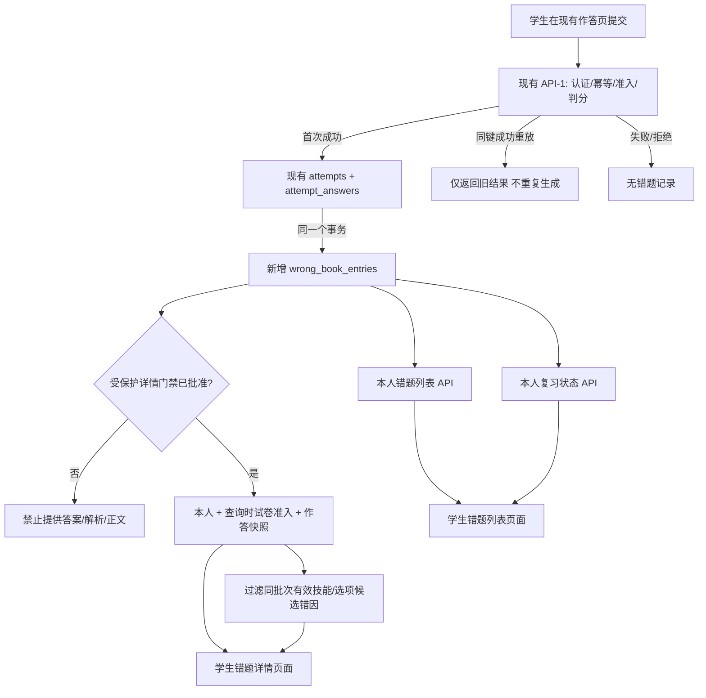

# 错题本模块开发文档

> 文档编号：WB-DEV-001
>
> 版本：V0.2（开发方案复审修订稿，**尚未获负责人签认**）
>
> 初稿日期：2026-11-21；修订日期：2026-11-23
>
> 项目：ShengShengRuEr（大学英语四六级听力个性化学习系统）
>
> 上位需求：[错题本模块需求文档 V0.2](../../requirements/wrong-book/requirements.md)；2026-11-19 总需求 V1.0。
>
> 仓库核查：`ShengShengRuEr-Team/ShengShengRuEr`，`develop@708829d2787e65f429b5d031cf33b60eb6d13c8c`。
>
> 状态：方案、接口及数据结构均为待签认的设计；本次修订工作为文档静态核验。

| 版本 | 日期 | 变化 |
|---|---|---|
| V0.1 | 2026-11-21 | 开发前设计草案 |
| V0.2 | 2026-11-23 | 按复审报告补充隐藏筛选、标注来源、模块二音频、历史解析门禁、字段语义及并发验收；拆分基础与受保护页面任务 |

## 0. 先读：必守红线与开发放行顺序

1. 错题本**复用既有登录、学生身份、整卷提交、服务端判分和 `attempt_answers` 快照**，不建立第二个作答系统。
2. **同一成功提交中的作答快照 + 错题归集必须在同一数据库事务中成功或回滚**；不能采用“提交成功后异步由浏览器写错题”的方案。
3. **不更改**现有提交 API-1 的请求、HTTP 错误/文案、幂等与限次顺序、原卷字母空间或练习估分逻辑；API-3 继续只返回本人提交状态/汇总。
4. 学生正常题库详情/音频原接口**不能因交卷而泄露答案、解析、原文**。错题详情需单独受保护的结果读取能力，并先完成 WB-D05 许可及原有 P1/P6 或等价门禁；未批准时接口关闭，不得暗中返回。
5. 模块三“题目错误选项的候选错因”**不是个人确认错因**。只读同批次、同选项、当期有效且已经审批的关联；旧规则、无证据、未经审核的结果不能当作正式候选。
6. **禁止在业务数据库上运行测试清库**。本项目 pytest 可能重建测试库 `public` schema：必须先创建隔离测试库、独立媒体目录，验证 `TEST_DATABASE_NAME` 不等于业务库。
7. 数据库使用增量 Alembic 迁移，不编辑旧迁移，不重复编号，不清空已有作答表、账号表、批次或审核数据；不得用数据补写伪造人工核听/批准。
8. **先评审需求+本方案，再建 Issue、冻结跨模块契约，再开发、提交 PR、独立验收**。开发人不为自己出具独立验收 PASS。

### 0.1 开发可实施/暂不可放行的内容

| 范围 | 开发可先做 | 对学生放行条件 |
|---|---|---|
| 自动归集、历史补录、SQL 与服务层 | 可以；须冻结 WB-D01 记录粒度 | 随合格提交链集成可上线 |
| 无答案/解析的个人错题列表 | 可以；需符合本人/当前访问权限 | 功能与权限测试通过即可 |
| 复习状态管理 | 可以写代码，业务口径须先确认 WB-D02 | WB-D02 签认 + 安全回归 |
| 逐题答案/解析的详情 | 可先设计/写受控代码、单元测试 | **WB-D05 明确批准、回写需求，并按 §4.5 核验 P1/P6 或等价审批对实际历史快照的覆盖范围** |
| 技能/候选错因/证据展示 | 可以实现过滤、内部测试 | 模块三审核/版本有效且展示内容权限批准，不触及原文红线 |

## 1. 代码现状核查（非推测）

| 关注点 | 已核实文件 | 当前事实与本轮对接 |
|---|---|---|
| 技术基线 | `docs/development/module-3/technical-version.md` | Python 3.13.16；API 独立锁文件；PostgreSQL、SQLAlchemy/Alembic；前端 React + Ant Design。禁止私自升级依赖 |
| 身份 | `backend/app/api/deps.py` | `require_student`；未登录 401，管理员 403；学生 ID 取 `current_user.id` |
| 提交 API | `backend/app/api/attempts.py` | `POST /api/v1/listening-papers/{id}/attempts`，`Idempotency-Key` UUIDv4，正常 200 返回汇总 |
| 提交核心 | `backend/app/services/attempts.py` | 首次成功分支调用 `insert_attempt_with_answers(...)` 后 `db.commit()`；现有锁/版本/限次/异常恢复不可改序 |
| 快照写入 | `backend/app/repositories/attempt_keys.py` | `insert_attempt_with_answers` 执行两次 flush，不执行 commit；适合在现有同一事务追加错题行 |
| 原始作答 | `backend/app/db/models_attempt.py` | `attempts` 与 `attempt_answers`；逐题保存 `id`, `attempt_id`, `question_no`, `question_id`, `selected_option`, `correct_option`, `is_correct`、题干选项解析快照 |
| 提交状态 | `backend/app/api/attempt_status.py` | API-3 仅返回 `submitted/attempt_count/latest_attempt`，**无逐题结果读取** |
| 模块二音频 | `backend/app/api/listening_papers.py`、[模块二音频接口](../module-2/api.md#3-获取试卷音频) | 音频路由已校验实时准入，支持可选的 `expected_batch_id` 和 Range |
| 模块二准入 | `backend/app/repositories/attempt_content.py`, `backend/app/repositories/listening.py` | `student_access` 控制当前批次/检查/管理员可见；旧卷与换批必须处理 |
| 技能/错因标注 | `backend/app/db/models_annotations.py` | `skill_question_relations`、`error_question_relations`、`question_annotation_states`、词典/证据等是已有持久化结构 |
| 模块三规则 | `docs/requirements/module-3/continuation-20261115.md` 及相关实现 | 新版选项级候选、证据/哈希/审核门禁；老版错因只审计；生成成功空候选合法 |
| 前端 | `frontend/src/router/index.tsx`, `frontend/src/constants/routes.ts` | React Router 学生守卫已有；现只有整卷列表/答题页，**无错题本路由/页面** |
| 测试 | `backend/tests/test_attempt_api.py`, `test_attempt_status_api.py` 等 | 必须补测试并复跑受影响作答/题库/模块三测试，不能引用旧 PR 数字当作本次通过 |

### 1.1 开发前复查

先记录本次实际 `git rev-parse HEAD`、`git status --short`、当前 `develop` SHA、`alembic heads`、`frontend/package-lock.json` 版本，及与其他同学任务的冲突清单。当前历史迁移包含 `0005_attempt_system`、`0007_m3_attempt_merge`、`0009_m3_error_invariants`；**新迁移的 revision ID 与 down_revision 以开工时实际 heads 为准，不能机械把本次写成固定 0010**。

## 2. 设计总览与责任边界



本模块只依赖既有作答事实、题库及标注的**读取**；不会让错误选项分析反向改动作答判分，也不让错题“已掌握”影响模块三题目审核状态。

## 3. 数据库设计（拟议，待评审后冻结）

### 3.1 为什么新增一张表

直接在 `attempt_answers` 查询 `is_correct=false` 可以推导错题事实，但缺少学生“已掌握/隐藏”状态，且未来补录、幂等与分页策略不易统一。因此建议只新增**一张轻量的个人状态/索引表**，不再次复制题干、答案或原文。真实内容以不可变的 `attempt_answers` 快照为准。

### 3.2 `wrong_book_entries` 建议字段

| 字段 | PostgreSQL / SQLAlchemy 建议 | 必填/索引/含义 |
|---|---|---|
| `id` | BIGINT identity / PK | 内部主键，不采用可猜 ID 作为授权依据 |
| `attempt_answer_id` | BIGINT FK → `attempt_answers.id` | 非空，`UNIQUE`，`ON DELETE RESTRICT`；**同一错误发生事实最多 1 条** |
| `learning_status` | VARCHAR(16) | 非空，`CHECK IN ('pending','mastered')`；默认 `pending` |
| `is_hidden` | BOOLEAN | 非空，默认 false；隐藏不删除 |
| `created_at` | TIMESTAMPTZ | 非空，UTC；历史补录取所属 attempt 提交时刻 |
| `updated_at` | TIMESTAMPTZ | 非空，UTC，状态变化时更新 |
| `reviewed_at` | TIMESTAMPTZ NULL | 首次或重新切换为 `mastered` 时写入，切换到 `pending` 时清空；隐藏或同值更新保留原值 |

附加索引 `ix_wrong_book_entries_learning_status(learning_status, is_hidden)`（仅当查询计划证明有益时保留）。`attempt_answer_id UNIQUE` 自带索引；使用 `attempt_answers.attempt_id → attempts.student_id` 访问已存在的 `ix_attempts_student_paper`。若真实数据量下分页成本过高，需以 `EXPLAIN ANALYZE` 提交证据，再考虑覆盖索引/冗余 student_id，不在未经评审时添加重复所有权列。

**必须满足的不变量**：`wrong_book_entries` 行仅能引用 `attempt_answers.is_correct=false` 的成功提交记录；写操作仅在服务层校验不足以防所有未来写入路径，因此**推荐通过插入路径封闭、仓储断言及反例集成测试保证**。若负责人要求数据库强约束，可用审慎评审的触发器保证关联正确性，但需评估批量迁移与回退；不能用跨表 `CHECK`（PostgreSQL 不支持这种语义）。

### 3.3 不新增的内容

- 不新建题目主表、个人答案表、独立错因词典表；不把答案、解析重复存到新表。
- 不在 `attempt_answers` 写“已掌握”、`is_hidden`，避免污染原始事实。
- 不删除 `attempts` / `attempt_answers`；也不覆盖历史 `import_batch_id`。

### 3.4 迁移与历史补录

1. **新迁移 `upgrade()`**：建 `wrong_book_entries`、CHECK/FK/UNIQUE、需要的索引；在隔离升级时验证旧数据对新表无影响。
2. **旧数据补录**：在已有历史成功提交与逐题快照上执行幂等批量插入，只针对 `is_correct=false`。示例 SQL（与最终命名/DB版本一致后再使用）：

```sql
INSERT INTO wrong_book_entries
    (attempt_answer_id, learning_status, is_hidden,
     created_at, updated_at, reviewed_at)
SELECT aa.id, 'pending', FALSE, a.submitted_at, a.submitted_at, NULL
FROM attempt_answers AS aa
JOIN attempts AS a ON a.id = aa.attempt_id
WHERE aa.is_correct = FALSE
ON CONFLICT (attempt_answer_id) DO NOTHING;
```

3. 补录只能插入缺失事实，**不能把已有 `mastered` 或 `is_hidden` 重置**。核对 `count(is_correct=false) == count(wrong_book_entries)`（在历史既有有效记录覆盖范围内），并提供遗漏行反查 SQL。真实数据库数量可能为空，不要硬编“25题/xx条错题”的验收结果。
4. 对于旧数据补录与新提交并发，推荐在部署窗口完成一次迁移/回填；必要时显式加部署门禁，不并行无序回填。任何失败应保留旧数据，迁移须可复验、可重试。
5. `downgrade()` 只处理本次新表/索引，并**警告会丢失用户新增复习标记**；发布回退优先回滚应用代码、保留新表，确需降库须先备份和由负责人批准。禁止回退时连带删掉 attempt 数据。
6. 运行 `alembic current`、`alembic heads`、`alembic upgrade head` 以及隔离库 `downgrade`/再升级，输出原始日志；不复写历史迁移文件。

## 4. 核心服务流程与事务实现

### 4.1 首次成功作答嵌入点

已核对 `backend/app/services/attempts.py`：在 `_first_submit` 成功分支构造 `Attempt` 和 `answer_rows` 后，现有代码是：

```python
insert_attempt_with_answers(db, attempt, answer_rows)
db.commit()
return _data_from_result(result, attempt)
```

**建议仅在两次 flush 之后、现有唯一 commit 之前**加入独立仓储函数 `insert_wrong_entries_for_answers(db, answer_rows)`。它只 `add/flush`，不自行 `commit`。以下为**伪代码/设计形态，不是已存在函数**：

```python
insert_attempt_with_answers(db, attempt, answer_rows)
# answer_rows 已在仓储函数中 flush，包含真实主键
insert_wrong_entries_for_answers(
    db,
    [answer for answer in answer_rows if not answer.is_correct],
)
db.commit()  # 原子：attempt + answer + wrong_book_entry
return _data_from_result(result, attempt)
```

- `answer.is_correct` 是服务端判分输出，**不可从客户端传入，也不能自行用展示字母重新算**。
- 当前作答成功/拒绝分支、两把 advisory transaction lock、E03/E04/E05/E07/E08/E09 顺序及错误文案保留；新插入失败应让整体事务回滚，并走既有安全异常恢复，不能在判分成功后吞掉错误继续 200。
- 客户端响应超时后按既有规则以相同键和内容重试。若事务已提交，沿用原提交与错题；若事务未提交成功，该次请求产生零条错题，仅后续成功提交可以归集。
- 同键成功 `REPLAY_SUCCESS` 分支**不新增错题**；事务中已有条目由唯一约束保护。旧成功数据由迁移/受控补录解决，不在重放时偷偷改变成功结果。
- `attempt_rejections` 永远不进入错题本。提交成功记录与错题条目数量的交集只取 `is_correct=false`。
- 如果有已成功作答却因历史存量缺条目的情况，使用经过授权、可重复执行的修复/补录工具；不能对单次响应宣称“数据已完整”而未检查。

### 4.2 读服务层分工

- `repositories/wrong_book.py`：只拼写 SQLAlchemy 查询，**不做 HTTP 响应、不 commit**，必须在 where 条件中把 `Attempt.student_id == current_user.id` 和查询时可访问状态纳入。
- `services/wrong_book.py`：统一校验权限、筛选、快照解码、可见性与标注规则；负责列表、详情、状态更新和数据投影；不得调用客户端控制的 student_id。
- `api/wrong_book.py`：依赖 `require_student`、严格 schema、路由注册、统一响应外壳和 `Cache-Control: no-store`。
- `schemas_wrong_book.py`：独立 Pydantic 输入/输出 DTO，`extra='forbid'` 处理无关字段，避免把 SQLAlchemy ORM 实体直接暴露为响应。

### 4.3 稳定的筛选与分页

- 只在后端过滤本人及其当前允许访问的试卷。过滤顺序逻辑上先判身份与可见性，再分页，**不得先拿全量 ID 分页后在浏览器过滤**。
- 排序建议 `attempts.submitted_at DESC, attempt_answers.question_no ASC, wrong_book_entries.id DESC`；如需稳定游标分页，最后使用 `id` 确保并列唯一。本方案采用 `page`/`page_size`，默认 1/20，`1<=page_size<=50`、`page>=1`，最大窗口/请求限制由评审确定。
- 关联 `exam_papers` 可取得级别/年月/套别；**题干关键词暂不搜索**，避免在权限未放行时全文搜历史内容。
- `visibility` 的三个模式见 API-WB01。本人、当前卷准入、可见性及其他筛选条件共同构成计数和查询的同一过滤集合，先过滤、后排序分页。
- 不可见旧卷记录不会被删；默认列表不返回受限行，恢复可见后可重新查询到。

### 4.4 详情快照读取与受保护字段开关

详情读过程必须满足：

1. 认证成功 `student` → 按错题 ID 查 `WrongBookEntry → AttemptAnswer → Attempt`，**同时限定 `Attempt.student_id = current_user.id`**，不符合则 404。
2. 检查 `Attempt` 属于成功提交（表本身保证），且原试卷查询时依旧满足学生可访问；否则 404。
3. **检查 WB-D05**：结果读取例外与内容治理门禁已书面/仓库同步确认，部署标志由服务端配置或版本化策略控制（默认关）。若未放行，**不返回受保护字段**；保持列表/管理可用，详情接口统一返回“暂未开放”而非部分答案。
4. 题目与判分取原卷作答快照，按 §4.5 校验受保护输出范围。使用原卷字母和原始答案，解析正文只读取获准的 `AttemptAnswer.explanation_text`。
5. 解析空白或受限时，`has_explanation=false` 且 `explanation=null`；用 `explanation_status` 区分缺失与受限。解析受限而其他字段已获授权时允许部分展示。其余保护字段未获准时走详情门禁。
6. 仅在 §5 的音频准入和来源条件满足时返回模块二受控入口。禁止返回磁盘路径、存储 key、长期签名链接和原文。
7. 设 `Cache-Control: no-store`，禁止浏览器持久缓存保护内容；页面离开时清除敏感详细状态，日志不记录题干/选项/答案/解析正文。

**提示**：现有作答系统只有 API-1 和 API-3，没有可复用的 API-2。不可将 API-3 改造成“含正确答案的宽松状态接口”；如需新建结果详情，应独立登记新接口及与上游安全条款的定向修订。WB-D05 不满足时不得合并对学生开放的受保护路由。

### 4.5 历史解析的放行依据

- WB-D05 由负责人签认。题库内容治理负责人核验历史解析原始快照并保存 P1/P6 或等价审批记录，注明签认人、日期、学生详情输出范围和决策来源。开发方依据可追溯审批配置服务端校验，非开发验收方核对审批与实际返回值。
- 放行记录须能匹配作答来源 `import_batch_id`、逐题身份 `attempt_answer_id`、字段 `explanation_text`，以及实际输出正文的 SHA-256（按快照原字符串的 UTF-8 字节计算）。可引用上游审核清单或不可变版本，但版本必须能解析到同样明确的字段范围和内容哈希。治理记录及哈希只供服务端核验，学生接口不返回。
- 从本次读取的历史快照计算哈希，按当前有效、未撤销的批准精确匹配，再投影获准正文。试卷当前可访问、当前解析获批、同一题号或批次身份单独使用时，都不足以放行历史解析。
- 原值为空或仅有空白时返回 `missing`，其余解析缺少匹配审批、审批失效或核验失败时返回 `restricted` 且正文为 `null`。其他受保护字段没有获准时，整个详情按 API-WB02 关闭。保持原始快照与判分，禁止替换成新解析或把内容写进日志。
- 反例：历史解析 H 含受限原文，当前解析 N 已删去该内容并通过审核。N 的审核范围或哈希不能匹配 H，详情省略 H 正文并显示受限；H 原值仍留在作答快照。该反例对应 WB-AC04/05 和 WB-SEC02。

## 5. API 契约提案（冻结后实施，不等同于当前已有接口）

**统一约定：** 前缀 `/api/v1`；返回 `{ "code": 200, "msg": "...", "data": ... }`，HTTP 状态与 code 对齐；字段 `snake_case`；JWT Bearer；错误体 `data=null`；401→403→404→校验错误；响应禁止泄露 SQL 原文/业务内部键。**下面所有 URL 都是新接口建议，当前仓库尚不存在。**

### API-WB01：查询本人的错题列表

`GET /api/v1/wrong-book?page=1&page_size=20&exam_paper_id=...&mistake_type=wrong&learning_status=pending&visibility=visible`

- 权限：student；未登录 401，管理员 403。
- `exam_paper_id` 可省略；可选 `mistake_type=wrong|unanswered`、`learning_status=pending|mastered`。可选 `visibility=visible|hidden|all`，省略等价于 `visible`。重复、未知、非法或超长参数返回 422。
- 成功返回**无答案/解析/原文的安全 DTO**：

```json
{
  "code": 200,
  "msg": "查询成功",
  "data": {
    "items": [{
      "wrong_book_id": 101,
      "exam_paper_id": 12,
      "paper": {"level": "CET4", "year": 2025, "month": 6, "paper_set": 1},
      "question_no": 5,
      "mistake_type": "wrong",
      "submitted_at": "2026-11-20T08:30:00Z",
      "learning_status": "pending",
      "is_hidden": false
    }],
    "page": 1,
    "page_size": 20,
    "total": 1
  }
}
```

`visible` 只返回未隐藏，`hidden` 只返回已隐藏，`all` 同时返回两类。假设本人当前可访问记录按排序依次为 105（可见）、104（隐藏）、103（可见）、102（隐藏）、101（可见），且无其他筛选：

| 请求（省略公共前缀 `/api/v1`） | `items` 中的 ID | `total` |
|---|---|---|
| `GET /wrong-book?page=1&page_size=2` | 105、103 | 3 |
| `GET /wrong-book?page=2&page_size=2&visibility=visible` | 101 | 3 |
| `GET /wrong-book?page=1&page_size=2&visibility=hidden` | 104、102 | 2 |
| `GET /wrong-book?page=2&page_size=2&visibility=all` | 103、102 | 5 |

恢复 104 后，`hidden` 的 `total=1`（仅 102），`visible` 的 `total=4`，`all` 的 `total=5`。恢复保留 104 的复习状态；`total` 计入所有符合筛选的记录，与当前页长度无关。日志仅记录路由、学生 ID、结果数量和错误类型。

### API-WB02：读取本人单条错题详情（受保护，默认禁用）

`GET /api/v1/wrong-book/{wrong_book_id}`

- 仅本人且查询时原试卷学生可访问；WB-D05 未审批：**API 保持关闭并返回 `503` / `msg="错题详情暂未开放"`**（可用统一 feature gate；**最终错误状态需与项目负责人确认**）；不可通过其它接口代取答案。
- 放行后示例（展示选项/标签为说明数据，**非真实卷内容**）：

```json
{
  "code": 200,
  "msg": "查询成功",
  "data": {
    "wrong_book_id": 101,
    "attempt_code": "550e8400-e29b-41d4-a716-446655440000",
    "paper": {"exam_paper_id": 12, "level": "CET4", "year": 2025, "month": 6, "paper_set": 1},
    "question_no": 5,
    "submitted_at": "2026-11-20T08:30:00Z",
    "question": {
      "text": "[示意题干]",
      "options": {"A": "[选项A]", "B": "[选项B]", "C": "[选项C]", "D": "[选项D]"},
      "selected_option": "B",
      "correct_option": "D",
      "explanation": null,
      "has_explanation": false,
      "explanation_status": "missing",
      "snapshot_note": "交卷时题目和判分快照"
    },
    "mistake_type": "wrong",
    "learning_status": "pending",
    "is_hidden": false,
    "skills": [],
    "candidate_error_causes": [],
    "personal_error_causes": [],
    "personal_error_confirmation": "unconfirmed",
    "annotation_note": "候选错因不代表个人已确认",
    "annotation_source_note": "关联标注来自该次作答来源批次的当前有效审核结果",
    "evidence_access": "none",
    "audio": {
      "status": "available",
      "url": "/api/v1/listening-papers/12/audio?expected_batch_id=42"
    }
  }
}
```

- `personal_error_causes=[]` 不表示学生无错因，仅表示**当前无可核实的个人确认记录**。
- `skills[]` 元素为 `{ code, name, role, definition, evidence_status }`，候选元素为 `{ code, name, option_letter, basis_summary, evidence_status }`。证据投影必须满足 §6.3 的学生白名单。
- `annotation_note` 和 `annotation_source_note` 分别表达个人确认边界和标注时间来源。详情字段、前端文案和 WB-AC07 使用同一口径。
- `option_letter` 对外一律**原卷字母**；从题库基准选项关联时必须通过该批次 `presentations` 的完整映射做**逆向投影**，不能把基准 B 当成原卷 B。若映射损坏/不唯一，跳过标注并记录安全异常，**但不得重新判分旧 attempt**。

#### 详情字段类型与空值

| 字段 | 类型及允许值 | 对外语义 |
|---|---|---|
| `question.selected_option` | A–D 字符串或 `null` | 原卷作答字母；`null` 为未作答 |
| `question.correct_option` | A–D 字符串 | 获准的原卷正确选项 |
| `question.explanation` | 非空字符串或 `null` | 获准的原解析逐字返回；缺失或受限时为 `null` |
| `question.explanation_status` | `available`、`missing`、`restricted` | 已放行有正文、源快照缺失/空白、有内容但未获准 |
| `question.has_explanation` | 布尔值 | 当且仅当响应携带解析正文时为 `true` |
| `skills[].definition` | 字符串或 `null` | 可公开的技能词典定义；无可用定义时为 `null` |
| `candidate_error_causes[].basis_summary` | 字符串或 `null` | 可公开的一般性误选机制说明；没有合规说明时为 `null`；具体原卷证据不写入该字段 |
| `evidence_status`（每个已展示标注） | `restricted` | 该关联有符合规则的证据，但具体证据不随本契约公开。证据无效时不投影对应关联 |
| `evidence_access`（详情） | `none`、`restricted` | 返回的标注数组都为空时为 `none`；至少一条关联已展示且具体证据受限时为 `restricted` |
| `annotation_note`、`annotation_source_note` | 字符串 | 分别说明候选归因边界、标注适用的来源和时间 |
| `audio.status` | `available`、`missing`、`batch_mismatch` | 可以尝试播放、同批次无可用音频、批次不同或无法确认对应 |
| `audio.url` | 站内相对 URL 或 `null` | 仅 `available` 提供 URL，其他状态均为 `null` |

上述 JSON 示例中选项为 B，解析缺失，无已展示标注。若解析存在但未获批准，仅将 `explanation_status` 改为 `restricted`。若出现一条符合审核规则的合法候选，可以同时返回其词典代码、一般机制说明和 `evidence_status: "restricted"`，详情级 `evidence_access` 为 `restricted`。完整依据另按 §6.3 处理。

#### 复用模块二的受控音频

1. **有音频。** API-WB02 同次检查当前学生准入及当前活动批次。从模块二已有解析逻辑读取音频绑定（优先批次 `audio_id`，其后为卷绑定），只有当前批次等于 `Attempt.import_batch_id` 且绑定可确认属于这一来源批次时返回 `available`。如果只能找到来源不明的卷级回退绑定，返回 `batch_mismatch`。学生页面标注“当前卷音频（同交卷来源批次）”，从受控 URL 取得试卷与批次 ID，复用模块二播放器及 `loadAudioSource(examPaperId, signal, expectedBatchId)`，以 Bearer 发起 `GET /api/v1/listening-papers/{exam_paper_id}/audio?expected_batch_id={当前批次ID}`。每次请求携带同一正整数 `expected_batch_id`，可加 `Range: bytes=0-`。现有播放器整段加载并用对象 URL 播放，正常返回 200；若分段请求则返回 206。对象 URL 应在退出详情、换记录或刷新后释放。
2. **无音频或无法确认对应。** 同来源批次无可用绑定时返回 `{"status":"missing","url":null}`，显示“暂无音频”；详情读取时已经换批，或不能证实当前绑定属于交卷来源时，返回 `{"status":"batch_mismatch","url":null}`，显示“当前音频与交卷批次无法对应”。页面仍可显示获准的历史题目，且不调用音频路由。
3. **详情返回后换批或下线。** 播放及后续 Range 请求沿用详情给出的 URL。批次发生变更但卷仍可访问时，模块二返回 409（`CURRENT_BATCH_CHANGED`），立即停播、清空播放器并刷新整条错题详情。卷已下线时实时准入返回 404，停止播放、刷新并在详情仍为 404 时清除已显示的保护内容。可访问但媒体丢失也可能在流请求返回 404；重新读取详情确认权限后显示“音频暂不可用”。401 交还统一登录处理，416 或 5xx 提示播放失败。错误处理不得去掉 `expected_batch_id` 重试或回退到无版本入口。准入和批次校验在每次请求时执行，已加载到客户端的音频不会因此自动收到下线通知；刷新或离开详情时须取消请求并释放本地播放资源。
4. **绑定边界。** `expected_batch_id` 校验批次身份，当前卷音频不属于交卷快照。若某条发布路径允许在同一活动批次内换绑且无法确认新音频对应，详情不得为该路径提供可播放入口，直到治理能够确认对应关系；不得声称该参数能识别同批次内媒体变更。

### API-WB03：修改本人复习状态（业务签认后开放）

`PATCH /api/v1/wrong-book/{wrong_book_id}`

请求至少包含一个可修改字段；仅允许 `learning_status`, `is_hidden`：

```json
{ "learning_status": "mastered", "is_hidden": false }
```

- 校验：`learning_status=pending|mastered`；`is_hidden` 必须是布尔；额外传 `correct_option`, `student_id`, `attempt_answer_id` 等均 422。
- 先限定当前学生所有权及查询时试卷准入，后更新，不可对他人记录返回存在性信息。
- 请求体禁止 `null`，至少提供一个合法字段。按记录行加锁后读取最新状态，只合并已提供的字段；多字段一次操作必须全成功或全失败，后一个并发事务基于锁释放后的最新状态写入，避免覆盖对方的另一个字段。
- 仅实际改变任一状态字段时更新 `updated_at`；`pending → mastered` 写入服务端当前 UTC 时间到 `reviewed_at`，`mastered → pending` 清空。隐藏与恢复单独更新时保留 `reviewed_at`；重复设置同值返回当前状态，两个时间均不刷新。
- 返回 `{wrong_book_id, learning_status, is_hidden, updated_at, reviewed_at}`，不返回答案/原文。`updated_at` 为非空 UTC ISO 8601 字符串，`reviewed_at` 为同格式字符串或 `null`。
- 恢复隐藏仅通过 `is_hidden=false`；不提供硬删接口。

### 5.4 统一状态与典型错误

| 状态 | 场景 | 要求 |
|---|---|---|
| 200 | 本人列表、被允许的详情、本人状态更新 | 仅返回相应 DTO，`Cache-Control: no-store` |
| 401 | 无 token/失效 token | 必须先于角色与资源判断 |
| 403 | 管理员访问个人错题接口 | 复用 `require_student` |
| 404 | 他人/不存在/本人但原试卷当前不可访问 | 统一中性文案，不暴露记录是否存在 |
| 422 | 参数非法、状态值越界、额外字段 | 不回显原始请求敏感值 |
| 503（拟定） | 受保护详情门禁未满足或数据库不可用 | 保持安全关闭；错误码/文案在签认后冻结 |
| 500 | 未知异常 | 统一服务端错误，不把 SQL/题库/环境信息返回 |

## 6. 技能与候选错因的数据投影（必须单独测试）

### 6.1 技能读取链

1. `Attempt.import_batch_id` 和 `AttemptAnswer.question_id` 给出**交卷来源题目身份**。
2. 查询 `skill_question_relations` 严格按 `(batch_id, question_id)` 关联；限定 `relation_kind='QUESTION_SKILL'`、有效当前修订及审核态；解析 `skill_id` 所属词典快照及第三级条目，保留 `role`（主要/辅助）。
3. 读取有效证据子关系，但**不把未经批准的正文片段发学生**；按服务端证据白名单投影。未得到可信审核/词典版本时返回空，不复活旧关系。
4. 题目有多个可用技能可按主要优先排序；无标注时显示“暂无已审核技能标注”，不影响错题记录本身。

### 6.2 选项候选错因读取链

1. `selected_option=null` → 个人选择不对应具体错误选项，候选数组为空；题目存在的其他候选也不能推断个人原因。
2. `selected_option='B'`（**原卷 B**） → 用该来源批次 `Presentation` 把原卷 B 转为题库**基准字母**（例如 C），按 `(batch_id, question_id, base_option_letter)` 精确匹配。
3. 查 `error_question_relations` 的 `QUESTION_ERROR_CANDIDATE` 父关系 + `CANDIDATE_EVIDENCE` 子关系；必须匹配当前有效修订、`business_eligible`、词典版本、生成状态、规则 manifest、审核会话、有效证据与当期模块三可读性判定。**`business_eligible=true` 本身不足以认定已审核可展示。**
4. 检查该选项**不是**该批次的正确基准选项；可以对应 0 条、1 条、多条候选，不假设“每错项一定有错因”。严格按 `(batch_id, question_id, base_option_letter, error_cause_id)` 去重，不误合并其他选项。
5. 仅给学生展示具有安全证据的候选说明与来源状态；**旧规则只审计**。若数据库迁移与新规则身份未同步（例如列允许的历史规则代码与最新工作流版本不一致），必须采用**当前模块三正式读取服务的校验口径**，而不是自行放宽 SQL 条件。
6. 对外转换回原卷选项字母，并标注“题目候选错因，不代表个人已确认”；**本轮不做个人错因推断或写入**。

### 6.3 证据展示分级（建议，须与题库治理确认）

| 数据类别 | 学生详情允许程度 |
|---|---|
| 题目级技能名称/代码及有效角色 | 在 WB-D05 和技能标签发布权限允许后可显示 |
| 选项级候选错因名称/定义与一般性解释 | 在审核/规则/权限均通过时可显示；始终写候选非确诊 |
| 具体审核人内部评语、来源文件路径/Hash、模型 receipt、证据内部 ID | 默认不开放 |
| 音频 | 仅通过模块二既有受控音频入口和实时权限校验 |
| 听力原文全文、原文片段、时间轴、可拼接的正文证据 | **默认禁止对学生下发**，除非另有明确书面修订与治理许可，不受普通错题详情放行自动授权 |

技术风险：现有部分候选证据绑定 transcript segment；不可将管理员标注响应直接传给学生，必须经过独立学生字段白名单。若无法在安全范围内提供原文依据，学生显示“存在受限证据，暂不可查看”，并将 WB-F04 的“完整依据展示”标记为条件性未完成，不能伪称通过。

## 7. 前端设计与交互约束

### 7.1 文件与路由建议

```text
frontend/src/
  api/wrong-book.ts                # 强类型 API 调用，统一错误适配
  api/wrong-book.types.ts          # DTO 与后端契约同名字段/类型
  pages/student/WrongBookListPage.tsx
  pages/student/WrongBookDetailPage.tsx
  pages/student/wrong-book/StatusActions.tsx
  pages/student/wrong-book/CandidateCausePanel.tsx
  pages/student/wrong-book/*.test.tsx
  constants/routes.ts             # 新增错题本列表与详情路径
  router/index.tsx                # 仅学生守卫下新增页面
  layouts/StudentLayout.tsx       # 添加“我的错题”导航
```

建议路由：`/student/wrong-book`、`/student/wrong-book/:wrongBookId`；当前未实现，需与团队路由命名约定评审后冻结。复用登录状态、现有统一 API 客户端、Ant Design List/Table/Card/Empty/Skeleton、全局布局，不引入第二套状态管理或认证库。

### 7.2 列表交互

- 进入时用 `visibility=visible` 请求本人分页列表，待复习与已掌握均可显示。切换“未隐藏 / 已隐藏 / 全部”或其他筛选项时重置到第 1 页，重新请求服务端。
- 数据为空区分“没有错题”与“筛选无结果”；加载失败提供重试，不能把错误伪装成“暂无错题”。
- 记录卡片仅展示安全字段。WB-D02 签认并开启管理能力后显示状态操作；“已隐藏”筛选提供恢复入口。操作后按当前筛选重新取数据和计数；如当前页超出结果页数，回到最后有效页。
- 服务端确认成功前不展示永久成功提示；更新失败保留原状态，并提供重试。
- 点击详情时由服务端再次判断本人/试卷可见性；页面不自行用本地缓存拼出答案。

### 7.3 详情交互

- 受保护接口未开放时，显示“此功能尚未开放”，而不是使用整卷详情/API-3 推断答案。
- `selected_option=null` 明确“未作答”；错选时以原卷 A–D 选项高亮，但不得把题库基准字母直接画为原卷选项。
- `explanation_status=missing` 显示“暂无解析”，`restricted` 显示“历史解析暂不可查看”；候选无有效标注显示“暂无候选错因”，个人错因显示“未确认”。
- 题目区显示“交卷时题目和判分快照”。在技能与候选错因区使用 `annotation_source_note` 说明它们来自该次作答来源批次的当前有效审核结果；候选区域同时显示 `annotation_note`，学生无需选择错因。
- 按 API-WB02 的音频状态显示播放器或空态；播放请求失败后按已定义流程停播、刷新和清理，题目仍使用获准的历史快照。
- 切换上一条/下一条、返回列表时保持列表筛选参数；路由切换/退出不持久化敏感详情正文。
- 使用 1280×720、1440×900 核验无遮挡、可滚动、可键盘操作和清晰加载/错误状态；[1024,1280) 做基础降级；不扩张为手机端交付。

## 8. 两人小组任务分解与交接

用户已明确“**我负责开发**”。下表将实际代码开发集中到开发人，另一位组员可负责文档/接口审查、测试用例设计与联调核查；**不擅自把另一位成员指定为具名独立验收人**。项目现有资料要求开发完成后有非开发人独立验收并留痕；如任务需两名独立验收者，应从小组之外补齐，不由开发者自验代替。

| 任务卡 | 负责人建议 | 前置 | 具体开发/审查动作 | 必交证据 | 对应验收 |
|---|---|---|---|---|---|
| WB-T00 需求与安全门禁 | 开发人整理；组员复核 | 总需求 V1.0 | 冻结 D01–D07，重点取得 D05 签认并同步 B04/B05/P1/P6；制定 Issue | 签认记录、Issue、变更对照 | AC05、AC14 |
| WB-T01 数据库与补录 | **开发人**；组员审查 | T00 记录粒度确认 | 新模型/增量迁移/UNIQUE/FK、旧成功数据补录及回退说明 | 迁移文件、SQL 行数核对、隔离库日志 | AC01/02/13 |
| WB-T02 归集接入 | **开发人**；组员审查 | T01 | 在提交首次成功同事务写错题；保持幂等锁、限次、错误顺序 | 定向 pytest、成功/失败/并发 SQL 证据 | AC01/02/12 |
| WB-T03 本人列表 API | **开发人**；组员测权限 | T01 | 过滤本人/学生可访问卷、分页与统计、无答案 DTO | OpenAPI、401/403/404、分页用例 | AC03/10 |
| WB-T04 复习状态 API | **开发人**；组员测边界 | D02、T01 | 严格字段白名单、原子更新、重复写幂等 | 状态持久化/越权/并发测试 | AC08/10 |
| WB-T05 受保护详情 | **开发人**；组员独立审查数据投影 | **D05 已放行**、T03 | 版本快照、历史解析核验、当前准入、模块二受控音频与功能门禁 | 快照对比、历史解析审批范围、权限及音频回归 | AC04/05/09 |
| WB-T06 技能/错因 | **开发人**；模块三维护人确认规则 | T05、模块三有效审核 | 同批次与基准映射、选项级候选、审核与证据过滤 | 多候选/空候选/旧规则/证据用例 | AC06/07/09 |
| WB-T07A 基础列表与管理页面 | **开发人**；组员审查界面 | T03；管理另需 D02/T04 | 学生导航、列表、筛选分页、空态及获批管理；详情门禁未开时提供中性提示 | 权限与筛选、状态交互和双分辨率基础 E2E | AC03/08/11（基础） |
| WB-T07B 受保护详情与标注页面 | **开发人**；组员审查界面 | T07A、D05/T05；标注另需 D06/T06 | 交卷快照、历史解析限制、标注来源与个人确认提示、受控音频 | 快照与标注对照、音频错误和双分辨率详情 E2E | AC04/05/07/09/11（详情） |
| WB-T08 全回归与交接 | **开发人提供自测；独立人员验收** | 所有已放行任务 | 隔离库全链路回归、PR、修复/复验与验收表 | 命令原始输出、commit SHA、PR、独立结论 | AC12–14 |

**依赖顺序建议：** `T00 → T01 → T02 → T03 → T07A` 可交付基础列表；并行完成 D02/T04 后接入管理。受保护页面在 D05/T05 与 T07A 完成后进入 T07B，标注接入另需 D06/T06。T08 按已开放阶段复验，完整交付需覆盖两个阶段。

### 8.1 双人审查与独立验收不混淆

- 组员 2 可以审查需求、开发文档、接口、迁移计划、测试用例、PR，提出问题并记录复核结论。
- 开发人必须本人实跑测试、修复问题、整理证据，并接受代码审查；**自测不能称独立验收**。
- 参照仓库模块二流程：任务由一人开发、两人独立验收后再交负责人；如目前只有开发人+一名非开发组员，需**另安排一名未参与实现的独立验收者**。不伪填签字或虚构通过记录。
- 最终合并遵守 `CONTRIBUTING.md` 的 PR 到 `develop`、至少非作者代码审核与已接入 CI 检查；仓库管理员按真实权限合并。

## 9. 测试设计（必须有反例，而非仅正常截图）

### 9.1 后端测试矩阵

| 测试 ID | 输入/场景 | 核心断言 | 需求锚点 |
|---|---|---|---|
| WB-UT01 | 4 题：1 对、1 错、2 未答 | 错题 3 条；类型 1 wrong + 2 unanswered | AC01 |
| WB-UT02 | 全对 | 错题 0 条；原提交正确率不变 | AC01 |
| WB-UT03 | 同 Key 同内容重试，分别模拟响应丢失和原事务回滚 | 已提交时重放同一 attempt_code、错题数不变；原事务回滚时零条，后续成功才归集 | AC02 |
| WB-UT04 | 不同 Key 争用同卷一次限制 | 仅一个成功；败者无错题，原 E08 不变 | AC02/12 |
| WB-UT05 | 人为令错题写入触发唯一/数据库错误 | attempt 与答案和错题一起回滚（或按原提交未知状态安全恢复），无“成功但漏记” | AC02/13 |
| WB-UT06 | 已有历史 2 条错误、手动已掌握 1 条后重跑补录 | 无重复，不覆盖已掌握/隐藏标志 | AC02/08 |
| WB-API01 | 学生 A 和学生 B 数据交错 | A 列表/详情只见 A，B 同理 | AC03/10 |
| WB-API02 | 未登录、管理员、猜测他人 ID | 401/403/404；没有敏感字段 | AC10 |
| WB-API03 | 试卷取消可见后请求 | 列表排除、详情 404、数据仍存在；恢复后查询正确 | AC05/09 |
| WB-API04 | 换批次且新卷已可见 | 详情使用提交时快照，不串新答案/标注 | AC04/09 |
| WB-API05 | 未授权详情能力 | 受保护字段不输出；旧学生端接口亦不输出 | AC05 |
| WB-API06 | 受保护能力获批、同一学生已提交 | 只返回其已提交快照，解析空白合法，`no-store` | AC04/05 |
| WB-API07 | 更新状态合法/非法/多余字段 | 合法可持久；非法 422；不更改原作答 | AC08/10 |
| WB-ANN01 | 原卷 B 映射基准 C，B 为学生错选 | 仅匹配基准 C 错因，对外标注原卷 B | AC06/09 |
| WB-ANN02 | 本题选项多错因/无候选/全未答 | 依选项精确展示多条或空；无个人确诊 | AC06/07 |
| WB-ANN03 | 旧规则、未审核/生成失败、跨批次证据 | 全部禁止出学生正式候选 | AC06/07 |
| WB-SEC01 | SQL 出错/对象不存在/超长分页 | 不泄漏 SQL、内部存储 key、标准答案或正文 | AC10/13 |
| WB-API08 | 混合隐藏状态且跨页，叠加学生/卷过滤；恢复一条隐藏记录 | 对照 API-WB01 三种模式、翻页和总数；恢复后记录转回可见且复习状态不变 | AC03/08 |
| WB-API09 | 两个客户端并发执行单字段 PATCH：已掌握与隐藏；分别重复请求并恢复 | 独立变更都保留；遗漏字段不变；同值重试不刷新任一时间；恢复保留掌握时间，待复习时清空 | AC08 |
| WB-API10 | 同来源有音频、无音频、来源不明，及详情后换批/下线 | 可用流 200/206；无音频或不对应时 URL 为 null；换批 409 后刷新；下线 404 后清理 | AC09/12 |
| WB-ANN04 | 原作答提交后，同一来源批次通过一版新的标注审核 | 获准快照与判分保持不变，标注采用当前有效审核结果；保留时间来源和个人确认两条提示 | AC07/09 |
| WB-SEC02 | 当前解析已批准，旧解析含受限原文；覆盖无匹配、哈希不同、审批撤回及合规快照获准 | 旧正文不出现在响应、缓存、日志；受限状态与缺失可区分；仅精确匹配且获准的快照返回原值 | AC04/05 |

### 9.2 前端测试与真实交互

- **组件**：列表加载、分页/筛选/空态、状态更新成功与失败、已隐藏恢复、错误详情访问、未作答展示、解析为空、候选错因提示。
- **路由**：未登录重定向；管理员进入学生错题页不可用，直接请求后端也无权限。
- **浏览器端到端（基础阶段）**：在隔离库创建两个学生和已可访问试卷，交卷后核对本人列表、分页和筛选；管理获批后验证状态切换、隐藏恢复、刷新/重新登录。关闭详情门禁时，基础流程仍可用。
- **浏览器端到端（详情阶段）**：门禁放行后核对交卷快照、受限解析空态、同批次标注修订与来源提示、无音频/音频换批，以及下线后权限拒绝和恢复。两阶段分别记录双分辨率结果。
- **界面证据**：1280×720、1440×900 的截图/录屏；页面无答案提前暴露，未出现空态误判。
- **真实卷内容**：若用真实四六级素材做人工业务核对，材料及音频的来源、版权/使用授权和人工核听状态须单独记录；技术合成样例不能代替真实卷语义审核。

### 9.3 回归不可漏项

- 模块一：登录/登出/JWT/管理员角色。
- 模块二：学生可访问判定、试卷列表详情、受控音频、学生响应无答案/原文；管理员内容不被破坏。
- 基础作答：API-1 提交 200/E03–E09、API-3 汇总、同键重试与多标签页并发、原卷映射、249 估分/不可用原因。
- 模块三：管理员上传/审核/正式入库、错误选项和证据规则、旧规则屏蔽；不得扩大为本轮已执行全部真实人工内容验收。
- DB：旧库升级和历史数据、单头迁移、downgrade/reupgrade（仅隔离库）、重启后的复习状态。

### 9.4 命令示例（在相应目录执行，**未执行**）

后端（Windows PowerShell，`backend/` 目录，先确定隔离测试数据库配置）：

```powershell
.\.venv\Scripts\python.exe -m alembic heads
.\.venv\Scripts\python.exe -m alembic current
.\.venv\Scripts\python.exe -m alembic upgrade head
.\.venv\Scripts\python.exe -m pytest tests/test_attempt_api.py tests/test_attempt_status_api.py tests/test_wrong_book.py tests/test_wrong_book_api.py
```

前端（`frontend/` 目录）：

```powershell
npm.cmd ci
npm.cmd run typecheck
npm.cmd run test
npm.cmd run build
```

> `tests/test_wrong_book*.py` 为本轮**计划新增**，当前仓库不存在；请开发时按最终命名调整。更广泛回归需按实际关联测试和项目现有验收脚本运行。**跑过哪些命令、结果如何，必须在 PR 中如实记录。**

## 10. 安全/一致性故障情形与恢复

| 风险编号 | 故障 | 应对与停止条件 |
|---|---|---|
| WB-R01 | 未批准详情绕过题库响应限制 | 默认 feature gate OFF；服务端白名单单独配置；未批准不返回详情保护字段，**阻断上线** |
| WB-R02 | 学生通过 ID 猜测读取他人错题 | 所有 SQL 限定登录用户与访问时准入；不存在/他人统一 404 |
| WB-R03 | 把基准选项当成原卷选项 | 同批次原卷/基准双向映射；非法映射禁显关联，不修改旧判分 |
| WB-R04 | 标注未经审核/旧版本却显示 | 正式模块三审核状态及规则版本双重门控；有效结果才读取 |
| WB-R05 | 单次提交成功但错题漏写 | 同事务；失败回滚并沿既有提交未知状态流程确认；不可静默 200 |
| WB-R06 | 历史补录重置掌握状态 | `ON CONFLICT DO NOTHING`，补录幂等并对照 SQL |
| WB-R07 | 学生将错题隐藏后误以为删除 | 前端明确“隐藏，不删除作答记录”；专用隐藏筛选和恢复入口 |
| WB-R08 | 卷下线造成旧题目泄露 | 读时校验 student_access；不泄露答案/题干/音频或标注证据 |
| WB-R09 | 数据库/媒体宕机 | 非 200 明确失败，前端保留原状态；不得从本机草稿伪造正确结果 |
| WB-R10 | 迁移在业务库执行清库测试 | 环境变量预检，测试库/媒体目录隔离；测试库不得等于业务库 |
| WB-R11 | 题库删除或试卷换批破坏 FK | FK RESTRICT 保留作答历史；版本按 attempt.import_batch_id；涉及删库必须走审批/备份 |
| WB-R12 | 多人并行误覆盖提交模块 | 最小 diff、单独分支、先锁定接口，定向回归 API-1/3，其他模块负责人代码审核 |
| WB-R13 | 当前解析已获准但旧快照仍包含受限正文 | 核验审批覆盖实际输出的历史解析；缺失、失效或不匹配时省略旧正文，原快照照常保留 |

## 11. PR、提交目录与交付清单

### 11.1 建议开发分支与 Issue

- 先建 Issue：标题“错题本模块：个人错题自动归集、查询与受保护详情”。编号由 GitHub 实际分配，**不预造 Issue #xx**。
- 从最新 `develop` 建分支，例如 `feature/wrong-book`；若团队要求含 Issue 编号，使用 `feature/<真实issue>-wrong-book`。
- 一个 PR 聚焦本模块；受保护详情门禁未满足时可分两步 PR（第一步底层与安全列表；第二步获得批准后详情/标注），但须在任务卡区分阻断状态。
- 提交说明形如 `feat(backend): 新增个人错题归集与查询`、`feat(frontend): 接入错题本列表和复习状态`；PR 目标 `develop`，不直接推 `main`/`develop`。

### 11.2 建议后端目录

```text
backend/app/
  api/wrong_book.py
  services/wrong_book.py
  repositories/wrong_book.py
  schemas_wrong_book.py
  db/models_wrong_book.py
  main.py                       # include_router(新增)
backend/alembic/versions/<实际新revision>_wrong_book.py
backend/tests/test_wrong_book.py
backend/tests/test_wrong_book_api.py
backend/tests/test_wrong_book_permissions.py
```

同时修改 `backend/app/services/attempts.py` 的**唯一成功落库位置**（尽量不改 `repositories/attempt_keys.py` 或 API-1 现有契约），以及 ORM 模型注册/迁移导入位置。文件名与项目命名约定再核对，不必机械照抄。

### 11.3 文档/测试/截图位置建议

```text
docs/requirements/wrong-book/requirements.md
docs/development/wrong-book/development.md
docs/development/wrong-book/api.md      # 开发时从本文 §5 提取冻结契约
docs/acceptance/wrong-book/report.md
docs/acceptance/wrong-book/evidence/   # 文本/JSON/截图、脱敏
```

**提交内容**：代码、锁定后的接口契约、Alembic 迁移、完整测试及运行说明、PR 描述、真实结果与原始错误日志、前端截图、独立验收结论。**禁止提交**：`.env`、JWT 密钥、生产库转储、真实用户作答、无授权真题原件、音频/模型大文件、含个人数据的请求日志、测试库密码。

## 12. 分阶段完成定义（DoD）

### Gate 0：开工前

- [ ] WB-D01–D07 实际负责人拍板；重点 WB-D05 受保护结果读取批准/回写状态明确。
- [ ] 记录最新 `develop` SHA、迁移 heads、受影响分支、接口消费者；Issue 和责任人明确。
- [ ] 两人审查本需求和开发文档，提出的问题有处理记录。

### Gate 1：数据归集、列表与基础页面（可独立先交付）

- [ ] 迁移在独立测试库升级、补录、重复执行及数据保持通过。
- [ ] 首次提交同事务创建错题；失败/幂等/并发不重复。
- [ ] 本人列表分页、当前可访问卷过滤、无答案/解析/原文；学生与管理员权限测试通过。T07A 基础页面完成双分辨率核验，受保护详情继续按独立门禁控制。
- [ ] 复习状态按获批规则持久化；未获批则明确未实现、不提前放行。
- [ ] 既有 API-1/API-3 回归无变化；附 SQL/测试原始证据。

### Gate 2：受保护详情与标注

- [ ] **WB-D05 已批准并回写**；题库内容治理记录可核验实际输出的历史解析，旧解析含受限原文反例通过；服务端开关与回归测试完成。
- [ ] 详情只读提交快照；当前卷准入、本人约束及 Cache-Control 严格有效。
- [ ] 技能/选项级候选错因经过同批次、规则、生成/审核、原卷字母映射与证据授权过滤。
- [ ] T07B 页面使用标注时间来源和个人确认两条提示；证据受限时完整依据仍为条件性未完成。受控音频在详情后换批、下线时正确停播并刷新。

### Gate 3：页面、回归和验收

- [ ] React 学生错题列表/详情/管理交互完整；至少两种桌面分辨率通过。
- [ ] API、安全、数据库、提交回归和端到端证据可复验，PR 标明 commit SHA 与实际运行时间。
- [ ] 非开发人独立验收；若项目要求两名独立验收，必须均完成且有原始记录。
- [ ] 遗留问题按严重程度列出 PASS/PARTIAL/FAIL/BLOCKED；**Gate 2 未通过不能整体标注 100% 完成**。

## 13. 验收记录模板（供实际人员填写；本文件不预填结果）

| 任务/AC | 实施代码与 commit | 执行命令/环境/真实证据链接 | 实际结果 | 结论 | 验收人/时间 |
|---|---|---|---|---|---|
| WB-AC01–02 自动归集/幂等 | 待填写 | 待填写 | 待执行 | NOT RUN | 待填写 |
| WB-AC03 列表 | 待填写 | 待填写 | 待执行 | NOT RUN | 待填写 |
| WB-AC04–05 详情与安全门禁 | 待填写 | 待填写 | 待执行 | **BLOCKED（待 WB-D05 签认）** | 待填写 |
| WB-AC06–07 标注 | 待填写 | 待填写 | 待执行 | NOT RUN | 待填写 |
| WB-AC08 管理 | 待填写 | 待填写 | 待执行 | NOT RUN | 待填写 |
| WB-AC09–10 历史/权限 | 待填写 | 待填写 | 待执行 | NOT RUN | 待填写 |
| WB-AC11–14 页面/回归/独立验收 | 待填写 | 待填写 | 待执行 | NOT RUN | 待填写 |

**结论口径**：PASS＝按当前提交与证据实际通过；PARTIAL＝部分通过或未覆盖重要边界；FAIL＝实际断言失败；BLOCKED＝外部决策/环境门禁未满足；NOT RUN＝尚未执行，不可改写为 PASS。发现问题需附文件/行号、请求或复现步骤、原始失败输出、最小修复建议以及复验 SHA。

## 14. 需求—开发—测试全链路追踪

| 需求 | 开发任务 | 关键接口/数据 | 测试 | 放行门禁 |
|---|---|---|---|---|
| WB-F01/BR01 自动归集 | T01/T02 | `attempt_answers` → `wrong_book_entries`、同事务 | UT01–06 | D01 |
| WB-F02/BR03 查询 | T03/T07A | API-WB01 + 个人/卷准入过滤 | API01–03、API08 | D03 |
| WB-F03/BR04 详情 | T05/T07B | API-WB02、历史快照与审查范围、模块二音频 | API04–06、API10、SEC02 | **D05，覆盖实际快照的 P1/P6 或等价审批** |
| WB-F04/BR05、BR07 标注 | T06/T07B | 同批次标注、来源提示与证据规则 | ANN01–04 | D06 + 模块三审核/权限 |
| WB-F05/BR06 管理 | T04/T07A | API-WB03 + 状态表 | API07–09 | D02 |
| WB-F06/BR07–08 权限/版本 | T03/T05/T06 | `student_access`、本人约束、原卷映射 | API02–05、SEC01 | D04/D05 |
| WB-F07 交付验收 | T07A/T07B/T08 | PR、测试、SQL、截图、复验报告 | 分阶段 E2E 与全量回归 | 非开发独立验收 |

## 15. 完整验收编号核对索引

| 编号 | 主要实现点 | 证据最低要求 |
|---|---|---|
| WB-AC01 | 同事务按 `is_correct=false` 归集（含未答） | 后端测试 + SQL 条数 |
| WB-AC02 | 幂等重放、并发、历史补录不重复 | 同键/双键测试 + 唯一约束/补录 SQL |
| WB-AC03 | 本人列表、分页、可见性筛选、统计 | 两学生交叉查询、各可见性模式的混合跨页与恢复样例 |
| WB-AC04 | 显示获准的历史快照 | 与 `attempt_answers` 比对、解析缺失与受限的显示证据 |
| WB-AC05 | 受保护字段授权与访问时准入 | WB-D05 签认、历史解析匹配证据和当前获批而旧解析不放行的测试 |
| WB-AC06 | 只读所选错误选项的有效候选 | 选项重排/多候选/空候选对照 |
| WB-AC07 | 技能主辅、标注时间来源、候选非个人确认与证据权限 | 同批次标注修订对照、来源文案、白名单与无原文泄露测试 |
| WB-AC08 | 状态持久、独立字段不覆盖且不改判分 | 并发、单字段、同值、恢复、重启与时间检查 |
| WB-AC09 | 换批后保留获准快照，标注与音频按来源处理 | 两批次测试、有/无音频、换批 409、下线 404 与页面清理 |
| WB-AC10 | 401/403/404 与跨用户隔离 | JWT/管理员/他人 ID/API 测试 |
| WB-AC11 | 基础页面与受保护详情分别验收 | 各阶段的 1280×720、1440×900 截图和 E2E |
| WB-AC12 | 模块一、二、三及作答模块回归 | 真实本轮执行的命令和日志 |
| WB-AC13 | 迁移、回退、重启持久化 | 隔离库升级/回滚日志与 SQL |
| WB-AC14 | 真实独立验收流程 | 两份有人员与 SHA 的独立记录（如项目要求） |

## 附录：资料来源与核查限制

**原始需求依据**：《技能与错因查询、错题本及题库管理需求文档 V1.0》（2026-11-19），其中第三章是错题本最直接的业务来源。

**仓库参考**（核查截至 2026-11-21）：

- `AGENTS.md`、`CONTRIBUTING.md`、`docs/development/startup-guide.md`
- `docs/requirements/attempt-system/requirements.md`、`docs/development/attempt-system/api.md`
- `docs/requirements/attempt-system/attempt-system-sync-20261116.md`
- `docs/requirements/module-3/continuation-20261115.md`、`docs/development/module-3/continuation-20261115.md`
- `backend/app/db/models_attempt.py`、`backend/app/db/models_annotations.py`
- `backend/app/services/attempts.py`、`backend/app/repositories/attempt_keys.py`
- `backend/app/api/attempts.py`、`backend/app/api/attempt_status.py`
- `frontend/src/router/index.tsx`、`frontend/src/constants/routes.ts`、`frontend/package.json`

**复审范围**：本稿为开发前设计，代码事实限定在上文历史基线。复审修订只做文档与示例静态核验；应用测试、迁移、真实内容审核和独立验收需另行留证。
